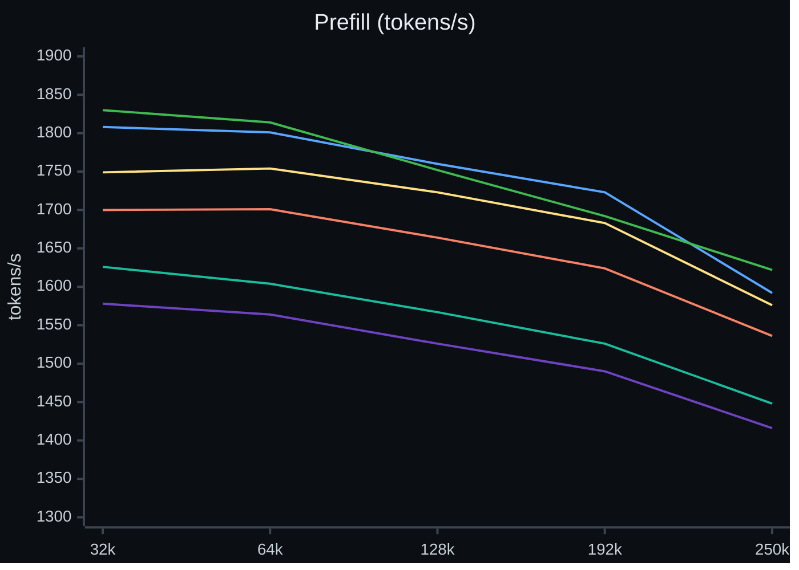
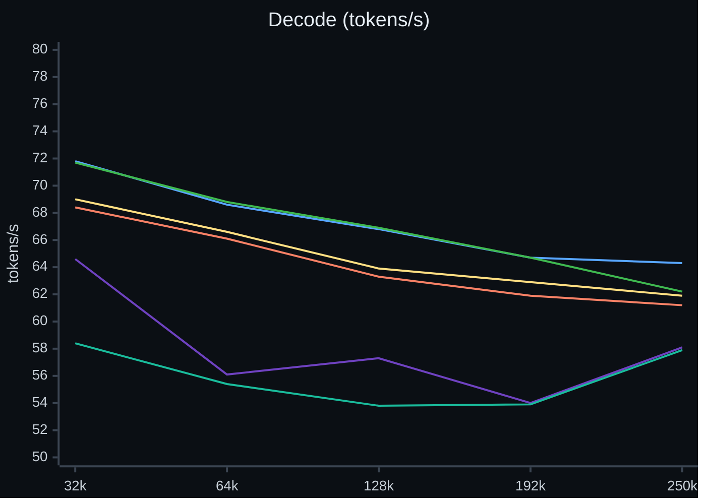

# Crucible

An inference engine for EXL3 checkpoints of Qwen3.8-Flash-Next on one AMD Strix Halo APU. It is built for fast long-context agent work.

Crucible runs **EXL3** checkpoints of **Qwen3.8-Flash-Next** on **AMD Strix Halo**: one **Ryzen AI Max+ 395** with a
**Radeon 8060S** (**gfx1151**) and 128 GB of unified memory. It uses its own **ROCm/HIP** kernels in C++20 and no other
engine. A local OpenAI-compatible server gives chat, streaming, function calls and exact speculative decoding. This is
research software for one GPU architecture. It is not a general model backend or a production service.

[How it got fast](docs/how-it-got-fast.md) · [Results](docs/RESULTS.md) · [Rivals](docs/RIVALS.md) ·
[Quality](docs/QUALITY.md) · [Changelog](CHANGELOG.md) · [Architecture](docs/ARCHITECTURE.md) · [Setup guide](docs/QUICKSTART.md) · [Build guide](docs/BUILD.md)

## Speed of this release

The tables below show the v0.34.0 release. The v0.34.0 column was measured Nov 7, 2026 on a build of v0.34.0 (it differs from the release engine in the version text only), balanced power profile (GPU clock 2,303 MHz on the 4.05 pack and 2,292 MHz on the 3.05 pack), with the public files and the six words listed below. The charts and the by-length text below still show the v0.33.0 release, because no chart run was made for v0.34.0. The tables hold the release ladder of each release, one column each. The 4.05 code value of the v0.34.0 column is the ladder row; the older columns take that row from the decode chart. The v0.33.0 column was measured Nov 3, 2026 on the v0.33.0 build, balanced power profile (GPU clock 2,289 to 2,295 MHz). The v0.32.0 column is the ladder run of Nov 3, 2026 on the v0.32.0 build. The 4-session row of that column has no value on the 4.05 pack: one session of each run stopped early. On the 3.05 pack it is from one of the two runs, for the same reason. The numbers of v0.32.0 in the text and in the charts come from the runs by context length. Those runs were measured Nov 3, 2026. The vision loader fix of v0.32.0 came after these runs; it changes only the vision load path, not prefill or decode.
In the tables, each value is the median of 2 runs (the v0.34.0 column: 2 runs, A and B). The server ran 4 sessions of 262,144 tokens with image input and speculative decoding (MTP)
on, as in daily use, with the public files and no tuned draft head file. The v0.34.0, v0.33.0 and v0.32.0 runs set two options that are unset in the engine itself: `CRUCIBLE_DRAFT_HEAD=q2` and `CRUCIBLE_DRAFT_CHAIN=hc8,lead` (see the [Changelog](CHANGELOG.md)); the earlier runs did not. They change the drafts only, and the verify pass checks every draft. `./crucible start` and the [Docker](docs/DOCKER.md) run line set these two words. They also set `CRUCIBLE_PLE_HOST=1` and `CRUCIBLE_COMPACT_STATE=1`, which are part of the measured configuration. The v0.34.0 and v0.33.0 runs also set `CRUCIBLE_PLE_FETCH=1`, a host read hint for the PLE table; the v0.32.0 runs did not. `./crucible start` and the Docker run line set all six words of this paragraph, with 4 streams of 262,144 tokens, `--conversation-cache-mib 9700` and `--host-reserve-mib 11264`. If you start the engine or `python -m server` yourself with none of them (no `CRUCIBLE_DRAFT_HEAD` and no `CRUCIBLE_DRAFT_CHAIN`), we expect decode as in v0.31.0; we did not measure that. `python -m server` alone keeps the conversation cache off (`--conversation-cache-mib 0`): every follow-up turn then prefills the whole conversation again, and the server prints a notice at start. The v0.34.0, v0.33.0 and v0.32.0 runs used prefill launches of 16,384 rows (`CRUCIBLE_PF_LAUNCH_ROWS=16384+128`, the default of the engine; the service sets it by name); the earlier columns used the settings of their own time (4.05 pack: 8,192 rows; 3.05 pack: 16,384 rows for v0.31.0 and v0.30.0, 8,192 rows for v0.26.0 and v0.22.0). Every row uses prompts that no
cache has seen, except the re-send row. The v0.32.0, v0.31.0, v0.30.0, v0.26.0 and v0.22.0 columns are earlier releases, measured with the same tool (4.05 pack: v0.32.0 on Nov 3, v0.31.0 on Nov 1, v0.30.0 on Oct 31, 2026, the other two in the run series of Oct 27 to 28, 2026; 3.05 pack: v0.33.0 and v0.32.0 on Nov 3, the others on Nov 1 to 2,
2026, with the public files and no tuned draft head file). What changed since v0.32.0 is in the [Changelog](CHANGELOG.md).

**4.05 bpw pack (the higher-quality option)**

| Row | v0.34.0 | v0.33.0 | v0.32.0 | v0.31.0 | v0.30.0 | v0.26.0 | v0.22.0 |
|---|---:|---:|---:|---:|---:|---:|---:|
| Cold prompt, 32K: first token (s) | 17.1 | 16.9 | 17.0 | 17.7 | 17.9 | 19.4 | 19.7 |
| Cold prompt, 32K: prefill (tok/s) | 1,831 | 1,851 | 1,841 | 1,763 | 1,741 | 1,613 | 1,585 |
| Cold prompt, 130K: first token (s) | 72.4 | 72.1 | 74.3 | 75.6 | 77.3 | 82.0 | 84.5 |
| Cold prompt, 130K: prefill (tok/s) | 1,782 | 1,789 | 1,736 | 1,707 | 1,669 | 1,574 | 1,527 |
| Same 32K prompt sent again: first token (s) | 0.019 | 0.020 | 0.021 | 0.021 | 0.023 | 0.014 | 1.870 |
| Decode at 32K, 1 session, code, paired run (tok/s) | 71.2 | 71.7 | 71.8 | 69.0 | 68.4 | 58.4 (2 low samples) | 64.6 |
| Decode at 32K, 1 session, prose (tok/s) | 58.4 | 56.3 | 57.6 | 55.2 | 53.3 | 50.5 | 50.4 |
| Decode, 4 sessions, total (tok/s) | 118.3 | 113.8 | n/a | 117.6 | 102.4 | 106.9 | 106.7 |
| Serial decode, no speculation, short context (tok/s) | 34.2 | 34.1 | 34.2 | 34.1 | 34.3 | 32.1 | 31.0 |

**3.05 bpw pack (the faster option)**

| Row | v0.34.0 | v0.33.0 | v0.32.0 | v0.31.0 | v0.30.0 | v0.26.0 | v0.22.0 |
|---|---:|---:|---:|---:|---:|---:|---:|
| Cold prompt, 32K: first token (s) | 16.6 | 16.7 | 16.7 | 16.8 | 16.9 | 19.2 | 18.9 |
| Cold prompt, 32K: prefill (tok/s) | 1,877 | 1,870 | 1,867 | 1,858 | 1,843 | 1,628 | 1,656 |
| Cold prompt, 130K: first token (s) | 71.1 | 71.3 | 72.4 | 72.8 | 74.2 | 81.5 | 81.0 |
| Cold prompt, 130K: prefill (tok/s) | 1,814 | 1,809 | 1,783 | 1,771 | 1,739 | 1,583 | 1,594 |
| Same 32K prompt sent again: first token (s) | 0.015 | 0.020 | 0.023 | 0.017 | 0.017 | 0.025 | 1.736 |
| Decode at 32K, 1 session, code (tok/s) | 76.8 | 73.9 | 74.0 | 75.4 | 76.7 | 70.8 | 71.5 |
| Decode at 32K, 1 session, prose (tok/s) | 60.7 | 60.3 | 58.9 | 57.2 | 59.4 | 58.4 | 56.3 |
| Decode, 4 sessions, total (tok/s) | 129.0 | 118.3 | 130.2 (1 run) | 128.1 | 127.2 | 125.8 | 128.3 |
| Serial decode, no speculation, short context (tok/s) | 39.1 | 39.3 | 39.3 | 39.2 | 39.5 | 36.5 | 35.4 |

Two runs per cell is a small sample. Against v0.33.0, the cold prefill rates of the v0.34.0 column are within 1.1% on both packs (the 4.05 pack reads 1.1% lower at 32K, and the two runs of that cell differ by 1.1%), decode with 4 sessions reads 3.9% higher on the 4.05 pack and 9.0% higher on the 3.05 pack, and serial decode is within 0.5%. Decode with 1 session changes between runs and between prompts, because the draft head predicts some text better than other text. In the run series of Oct 27 to 28, 11 builds span 60.5 to 66.9 tok/s on the 4.05 code row, so a difference of that size in the decode rows is not a result. The cold prefill rows and the re-send row move less. The 4.05 code row
comes from the decode chart (v0.22.0 and v0.26.0 Oct 29, v0.30.0 Oct 31, v0.31.0 Nov 1, v0.32.0 and v0.33.0 Nov 3). Against v0.32.0 in the runs by context length (same tool and prompts; v0.32.0 measured Nov 3, v0.33.0 on Nov 3, see
[Results](docs/RESULTS.md#decode-by-context-length)), the prefill rate of v0.33.0 changes by -1.8% to +1.9% on the 4.05 pack and by +1.5% to +2.6% on the 3.05 pack, per context length from 32K to 250K (ratio of the medians),
and the decode rate changes by -3.2% to +0.4% on the 4.05 pack and by +1.7% to +2.9% on the 3.05 pack. On the 4.05 pack the change is not the same at each length: prefill reads 1.2% higher at 32K and 1.8% lower at 192K, and decode reads equal at 32K (+0.1%) and 3.2% lower at 250K. The two runs are on the same day but not in one session, so a part of the difference is the clock and the load. We report the ranges and do not claim a gain or a loss on that pack. On the 3.05 pack the gain holds at every length. Decode with 4
sessions on the 4.05 pack reads 117.6 tok/s for v0.31.0 (Nov 1), 102.4 for v0.30.0 (Oct 31; the two runs gave 98.3 and 106.6) and 106.9 for v0.26.0; this row varies between runs, so a difference of one table value is not a result by itself. All 3.05 columns ran with the public files and no tuned draft head file. The v0.32.0 column on the 4.05 pack has no 4-session value: one session of each run stopped after 13 tokens. On the 3.05 pack one session of the second run stopped after 5 tokens, so that value is from one run. All values use the balanced power profile; the performance profile gives
other prefill rates ([Rivals](docs/RIVALS.md#the-power-profile-run-of-oct-26-2026)). More data, the method and the older tables are in [Results](docs/RESULTS.md).

**Prefill by context length, 4.05 bpw pack** (tokens per second, median of 4 runs per point for v0.22.0 and v0.26.0, run of Oct 28 to 29;
2 runs per point for v0.30.0, run of Oct 31, for v0.31.0, run of Nov 1, for v0.32.0, run of Nov 3, and for v0.33.0, run of Nov 3, 2026). Lines: v0.22.0 purple, v0.26.0 teal, v0.30.0 orange, v0.31.0 yellow, v0.32.0 blue, v0.33.0 green.



**Decode by context length, 4.05 bpw pack** (tokens per second, median of up to 4 samples for v0.22.0 and v0.26.0, up to 6 for v0.30.0, v0.31.0 and v0.32.0; v0.22.0 and v0.26.0 from the run of
Oct 29, 2026, v0.30.0 from the run of Oct 31, 2026, v0.31.0 from the run of Nov 1, 2026, v0.32.0 and v0.33.0 from the runs of Nov 3, 2026; v0.22.0 purple, v0.26.0 teal, v0.30.0 orange, v0.31.0 yellow, v0.32.0 blue, v0.33.0 green).



All 5 builds got the same prompts. On the same prompts and the same reply text, v0.30.0 decodes 1.06 to 1.08 times as fast as v0.26.0 from 64K to 250K, and 1.07 times at 32K in run 2 (1.20 with run 1, in which v0.26.0 read low). The v0.30.0, v0.31.0 and v0.32.0 lines hold up to 6 samples per point; the other two hold up to 4. The v0.32.0 run set the options named above (draft head, draft chain, launch rows); the others did not. v0.26.0 read low in run 1 at 32K (47.2 and 51.6 tok/s, the others 62.9
to 64.7); the cause is not found. The third question of each unit of the run of Oct 29 was invalid (a 10-token reply, no decode
number). The 3.05 chart and the data are in [Results](docs/RESULTS.md#decode-by-context-length).

## How it compares

Our own measurements of Halogen 0.18.14 and Gufo 0.22.0 on the same machine, with the same prompts and client, Oct 23 to 26,
2026. The GPU clock was similar; in the prefill rows Halogen ran about 3% higher. Each value is the median of 2 rounds. Each
Crucible value is the 4.05 pack and the Crucible build of that date (v0.26.0 or a build of Oct 25), older than v0.32.0. Bold marks the fastest.

| Row | Halogen 0.18.14 | Gufo 0.22.0 | Crucible, same run | Measured |
|---|---:|---:|---:|---|
| Serial decode, no speculation, short context (tok/s) | **42.2** | 29.3 | 32.2 | Oct 23 to 24 |
| Decode, mixed text, 1 session, speculation (tok/s) | **75.0** | 45.2 | 62.3 | Oct 23 to 24 |
| Decode, 4 sessions at 32K, total (tok/s) | 96.5 | 90.4 | **111.4** | Oct 23 to 24 |
| Cold prefill, 32K, balanced power profile (tok/s) | **1,938** | 1,693 | 1,614 | Oct 23 to 24 |
| Cold prefill, 32K, performance power profile (tok/s), Crucible build of Oct 25 | **2,121** | 1,843 | 1,870 | Oct 26 |

Halogen leads one-session decode and cold prefill at equal bits. It stores the layers that mix the hidden streams in 6 bits, and
its pack has 4.16 bits per weight. Crucible leads with 4 and 8 sessions. At equal bits (4.05), Halogen also leads decode with speculation on code (104.9 against 89.1 tok/s). The 3.05 pack has a lower KL divergence than the pack of Halogen (see below). All rows, dates, packs and the method are in [Rivals](docs/RIVALS.md). Newer versions exist (Halogen 0.18.18, Gufo v0.27.0, both Oct 29, 2026); we measured neither, and we did not measure the rival values again for v0.32.0. Thank you to the authors of Halogen and Gufo: their engines made this comparison possible.

## Why Crucible

- Batching, cache state and speculation do not change the tokens of a request. Speculative decoding changes the speed, not the tokens: the target model checks every draft token, and
  only checked tokens commit. Load and speculation depth do not change the tokens either. Each speed change must give
  byte-identical tokens on a fixed gate set before it merges ([exactness rules](docs/ARCHITECTURE.md#exactness-rules)).
  [Session replay](docs/SESSION_REPLAY.md) lists the cases in which a cache resume gives other tokens than a cold prompt.
- **Quality per bit.** KL divergence from the 16-bit (BF16) model, on 896 text positions, scored by us on Oct 24 to 25, 2026 (lower is closer). Gufo 0.22.0
  returned no log-probabilities, so it has no row (v0.27.0 serves them; not scored). [Quality](docs/QUALITY.md) has older tables.

| Engine and pack | Bits per weight | KL from BF16 | Same top token as BF16 |
|---|---:|---:|---:|
| Crucible 4.05 | 4.05 | **0.0230** | **94.3%** |
| Crucible 3.05 | 3.05 | 0.0513 | 91.7% |
| Halogen 0.18.14 | 4.16 | 0.0648 | 90.3% |

- **The conversation cache.** A later turn pays only for its new tokens. Sending the same 32K prompt again gives the first token
  after 0.021 s instead of 1.87 s in v0.22.0 (v0.26.0: 0.014 s; 4.05 pack). An optional disk tier keeps conversations
  across a restart.

## Quick start

**New machine?** Follow the [setup guide](docs/QUICKSTART.md): each step has a check, for a person or an LLM agent. It also has a
[one-command install](docs/QUICKSTART.md#one-command) and [Run as a service](docs/QUICKSTART.md#run-as-a-service).

### Build

```sh
make   # needs the software under "Requirements"; writes build/engine/crucible
# if make stops with "argument facts drift" on another ROCm, run: make SPLIT=0
```

### Download a model

Read the [model license note](#licenses) first. Keep every tokenizer file, weight shard, n-gram table and MTP mixer patch of the pack
([all packs](https://huggingface.co/turboderp/Qwen3.8-Flash-Next-exl3)). The 3.05 payload alone is about 84.45 GB.

```sh
PACK=3.05bpw_h5_ng5   # or 4.05bpw_h6_ng6, the higher-quality pack
CKPT="$PWD/models/Qwen3.8-Flash-Next-exl3-$PACK"
hf download turboderp/Qwen3.8-Flash-Next-exl3 --revision "$PACK" --local-dir "$CKPT"
```

### Run

```sh
python -m server "$CKPT" --engine build/engine/crucible --ctx 32768
curl -sS http://127.0.0.1:8790/v1/chat/completions -H 'Content-Type: application/json' \
  -d '{"model":"crucible","messages":[{"role":"user","content":"Say hello."}],"temperature":0,"max_tokens":32}'
```

This line is a short test: it keeps the conversation cache off and sets none of the words of the speed table, so a long conversation prefills again on every turn. For the measured configuration, use step 6 of the [setup guide](docs/QUICKSTART.md) or the [Docker](docs/DOCKER.md) run line. With 4 sessions of 262K tokens and `--vision` on the 4.05 pack, no launch-row setting is needed. The default (`16384+128`) fits 4 sessions of 262K with `--vision` on the 4.05 pack (stage arena 2,174 MiB); `8192+128` uses 1,439 MiB and gives a slower cold prefill.

**Security.** The server binds to `127.0.0.1:8790` and needs no key there. A key is required for an address that is not loopback, except in the Docker image. Give the key as a file (`--api-key-file PATH`);
without it the server exits before it loads the model. With a key, every route but `GET /health` needs it.
There is no TLS: to reach the server from other machines, use a reverse proxy ([security](SECURITY.md), [remote access](docs/REMOTE_ACCESS.md)).
The Docker image listens on all container addresses with no key and no default Host list, and warns at start: publish its port to
`127.0.0.1` only, or use a key ([Docker](docs/DOCKER.md)). Do not use the server as a public service.

The API provides `/v1/chat/completions`, `/v1/completions`, `/v1/models` and `/tokenize`. Use `stream: true` for server-sent events
and OpenAI `tools` definitions for function calls ([server guide](server/README.md), [OpenAI clients](docs/OPENAI_CLIENTS.md)).

To watch the engine live (requests, rates, memory, engine switch), see [Kiln](https://github.com/jaedync/crucible-kiln), a dashboard and OpenAI-compatible gateway for Crucible.

### Requirements

Ryzen AI Max+ 395, Radeon 8060S (gfx1151), 128 GB shared LPDDR5X-8000; Linux (tested: Arch Linux with kernel 7.2.7 and ROCm 7.2.4); a C++20 HIP compiler, GNU Make and POSIX threads; Python 3.12 or newer
(`requirements-cpu.txt`); disk space for one checkpoint and the build. Set `CRUCIBLE_PLE_HOST=1` to keep the n-gram table in host
memory (32.6 GB at 3.05, 39.0 GB at 4.05). The CPU tests run with `make -j2 test-cpu` and need no GPU ([all targets](docs/BUILD.md)).

## Features

- Exact speculative decoding with the model's draft head, and a keyed sampling law: a seeded request gives the same tokens at any speculation depth ([how](docs/how-it-got-fast.md#3-guess-ahead-and-check)).
- Local OpenAI-compatible server: chat, streaming, tools, up to 8 sessions on one engine ([server guide](server/README.md)).
- Conversation cache with an optional disk tier (`--state-dir`) ([session replay](docs/SESSION_REPLAY.md)).
- Image input, opt-in with `--vision`. No video.
- EXL3 packs from 2.18 to 4.18 bits per weight load. The qualified packs are 3.05 and 4.05 ([changelog](CHANGELOG.md)).
- Opt-in 16-bit n-gram table, built with one command ([NGRAM16](docs/NGRAM16.md)).
- Update by hand with `make update`, with a rollback; an optional timer ([Updates](#updates)).
- Hardware ceilings measured on the chip, and each speed claim names its ceiling ([calibration](docs/CALIBRATION.md)).

## Roadmap

In priority order. Each item moves only when a measured row moves.

1. More accepted tokens for each weight pass: a better draft head for prose and chat, and verify passes that cost close to a serial step.
2. Single-session decode: fewer bytes read for each token and fewer gaps between kernels. Serial decode uses 70% to 77% of the measured memory bandwidth (Oct 22 audit).
3. Cold prefill: the MoE matrix products, and cold prompts launched in pairs. Cold prefill is at 53% to 56% of the estimated WMMA ceiling (Oct 22 audit).
4. Quality per bit: more packs, mixed precision, the 16-bit n-gram table as a default if it pays.
5. Serving: cache memory, the disk tier, and a shared prompt start between sessions.

## Updates

Releases are numbered `v0.<train>.<fix>`; the notes are in [CHANGELOG.md](CHANGELOG.md) and on the Releases page. The server
shows its version at start. Once in 24 hours it asks GitHub if a newer release exists (one plain request, nothing else, no change
to your files). Turn this off with `CRUCIBLE_NO_UPDATE_CHECK=1` or `--no-update-check`. `make update` builds the newest release and runs a
short self-test; it restores the previous release when a step fails. `make rollback` undoes one update. Automatic updates are off
by default. The commands, the timer and the details are in [UPDATES](docs/UPDATES.md).

## Documentation

- [How it got fast](docs/how-it-got-fast.md): the six ideas behind the numbers, in plain words.
- [Results](docs/RESULTS.md): release data, method, hardware limits, history. [Benchmark suite](docs/BENCHMARKS.md).
- [Rivals](docs/RIVALS.md) and [Quality](docs/QUALITY.md). [Changelog](CHANGELOG.md).
- [Measurement details](docs/RESULTS.md#measurement-details) and [hardware limits](docs/CALIBRATION.md).
- [Architecture](docs/ARCHITECTURE.md), [forward specification](docs/FLASHNEXT_FORWARD.md), [EXL3 format](docs/EXL3_FORMAT.md), [build guide](docs/BUILD.md).
- [Third-party terms](docs/THIRD_PARTY.md). Progress report: [https://srv.jaedyn.me/strix-halo-engine-optimization/index.html](https://srv.jaedyn.me/strix-halo-engine-optimization/index.html).

Limits: only the named packs and gfx1151 are qualified. The server has no TLS and no tenant isolation, and one key is the only access control. The conversation
cache is opt-in and sits in host memory unless the disk tier is on. Generated tool arguments can be invalid: the server reports the
error and never runs a tool. A long-context timing is not a quality test.

## Licenses

The engine uses Apache-2.0 ([LICENSE](LICENSE), [NOTICE](NOTICE); the ExLlamaV3 notice is in `NOTICE`). **The model weights use
other terms.** Both supported EXL3 packs use the Qwen Community License 1.0, and commercial use has additional conditions. Read
[the model license note](docs/THIRD_PARTY.md#model-weights) before you download or use a pack. This repository does not include the weights.
