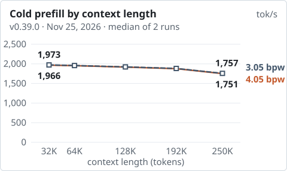
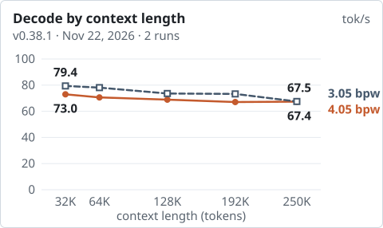
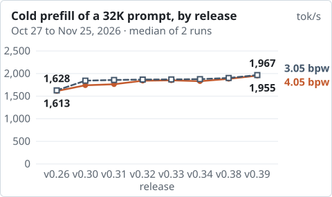

# Crucible

An inference engine for one model on one machine: Qwen3.8-Flash-Next (EXL3) on AMD Strix Halo, a Ryzen AI Max+ 395
with 128 GB. Its OpenAI-compatible server gives local coding agents 4 sessions of 262,144 tokens.

<!-- results:start charts -->
<p>
<picture><source media="(prefers-color-scheme: dark)" srcset="docs/img/prefill-by-context-dark.svg"></picture>
<picture><source media="(prefers-color-scheme: dark)" srcset="docs/img/decode-by-context-dark.svg"></picture>
</p>

<sub>One request at a time, default configuration, balanced power profile, v0.38.1 (Nov 22, 2026).</sub>
<!-- results:end charts -->

## Install

<!-- The two ways below are whole blocks. To change their order, move one block above the other; no other edit. -->
**One command.** It downloads the release engine (about 25 MB) and checks its sha256.

```sh
curl -fsSL https://raw.githubusercontent.com/jaedync/crucible-strix-halo/main/install.sh | bash
```

**Build from source.** It takes about 16 minutes with the ROCm 7.2.4 compiler
([steps](docs/QUICKSTART.md#step-4-build-the-engine)).

<!-- results:start clone -->
```sh
git clone --branch v0.38.1 https://github.com/jaedync/crucible-strix-halo.git
cd crucible-strix-halo
./crucible setup
```
<!-- results:end clone -->

Setup checks the machine, downloads the model (about 107 GB), starts the server and sends a test request. Then send
your own:

```sh
curl -sS http://127.0.0.1:8790/v1/chat/completions -H 'Content-Type: application/json' \
  -d '{"model":"crucible","messages":[{"role":"user","content":"Say hello."}]}'
```

Read more: [setup guide](docs/QUICKSTART.md) · [service](docs/QUICKSTART.md#run-as-a-service) ·
[Docker](docs/DOCKER.md) · [clients](docs/OPENAI_CLIENTS.md) · [updates](docs/UPDATES.md)

## What you need

- **Machine:** Ryzen AI Max+ 395 with Radeon 8060S (gfx1151) and 128 GB of memory, or 96 GB
  (3.05 pack only). Other machines are not supported.
- **System:** Linux with Python 3.12 or newer, tested on Arch Linux.
- **ROCm:** the release engine is built with ROCm 7.2.4. It runs on ROCm 10.1 (recommended) and on 7.2.4.
- **GPU memory:** two kernel parameters let the GPU use system memory. Setup applies them after you type
  `yes`.
- **Disk:** an SSD, about 110 GB for the model (125 GB for 4.18), and up to 200 GiB for the conversation cache.

Read more: [step 1 and step 2 of the setup guide](docs/QUICKSTART.md#step-1-rocm-the-hip-compiler-and-gpu-access)

## Configurations

Setup installs the pack [`4.05bpw_h6_ng6`](https://huggingface.co/turboderp/Qwen3.8-Flash-Next-exl3/tree/4.05bpw_h6_ng6).
`--pack 3.05` installs [`3.05bpw_h5_ng5`](https://huggingface.co/turboderp/Qwen3.8-Flash-Next-exl3/tree/3.05bpw_h5_ng5),
faster, lower [quality](docs/QUALITY.md). `--pack 4.18` installs
[`4.18bpw_h6_ng8`](https://huggingface.co/turboderp/Qwen3.8-Flash-Next-exl3/tree/4.18bpw_h6_ng8), 4.05 quality, slower, 128 GB only.
`./crucible setup --layout NAME` sets the sessions:

- `default`: 4 sessions of 262,144 tokens.
- `long`: 1 session of 524,288 tokens and 2 of 262,144.
- `two-long`: 2 sessions of 524,288 tokens.

Each needs about 28 GB of GPU memory for the sessions. Up to 262,144 tokens, all three give the same
tokens. A longer request uses YaRN. Measured in `long`:

<!-- results:start long -->
| `long`, 4.05 pack | 250,000 tokens | 490,000 tokens (YaRN) |
|---|---:|---:|
| Cold prompt: first token | 148.0 s | 342.4 s |
| Cold prompt: prefill | 1,688.9 tok/s | 1,427.8 tok/s |
| Decode, code | 64.1 tok/s | 63.4 tok/s |

<sub>v0.38.1, measured Nov 22, 2026: 1 run, balanced power profile.</sub>
<!-- results:end long -->

Read more: [long context](docs/LONG_CONTEXT.md)

## Speed by release

<!-- results:start releases -->
<p>
<picture><source media="(prefers-color-scheme: dark)" srcset="docs/img/prefill-by-release-dark.svg"></picture>
</p>

<sub>Each release ran with the settings of its own time, balanced power profile.</sub>
<!-- results:end releases -->

<!-- results:start table -->
| v0.38.1 | 4.05 pack | 3.05 pack |
|---|---:|---:|
| Cold 32K prompt: first token | 16.6 s | 16.5 s |
| Cold 130K prompt: first token | 70.0 s | 69.4 s |
| Same 32K prompt again: first token | 0.009 s | 0.009 s |
| Decode at 32K, 1 session, code | 72.8 tok/s | 79.1 tok/s |
| Decode at 32K, 1 session, prose | 58.8 tok/s | 63.4 tok/s |
| Decode, 4 sessions, total | 112.2 tok/s ¹ | 127.8 tok/s |

<sub>v0.38.1, measured Nov 22, 2026: median of 6 texts (decode: mean, 3 runs a text), balanced power profile, default configuration.</sub>

<sub>¹ 4.05 pack, Decode, 4 sessions, total: 5 of 6 texts gave a value.</sub>
<!-- results:end table -->

The 4-session row uses warm prompts and the all-4 window. 4 sessions, one new 32K prompt: last first token after 17.4 s (was 79.5 s).

[Method](docs/RESULTS.md) · [History](docs/HISTORY.md) ·
[Rivals](docs/RIVALS.md) · [Development](docs/how-it-got-fast.md)

## Features

- Its own ROCm/HIP kernels in C++20.
- Speculative decoding that is exact: the model checks every draft token, so only the speed changes.
- A conversation cache in memory and on the SSD. A later turn pays only for its new tokens, also after a restart.
- An OpenAI-compatible API with streaming, tool calls and image input, up to 8 sessions.
- One tool, `./crucible`, for setup, checks, the service, updates with rollback, and removal.
- [Kiln](https://github.com/jaedync/crucible-kiln), a dashboard and OpenAI-compatible gateway for Crucible.

## Read more

- [Architecture](docs/ARCHITECTURE.md), [server guide](server/README.md) and [all documents](docs/README.md).
- [Changelog](CHANGELOG.md): the changes and the known limits of each release.
- [Security](SECURITY.md) and [remote access](docs/REMOTE_ACCESS.md). The server listens on `127.0.0.1` with no key
  and no TLS. A key is required for a public address, except in the Docker image.
- [Updates](docs/UPDATES.md): once in 24 hours the server asks GitHub if a newer release exists.
  `--no-update-check` turns this off.

This is research software for one GPU architecture. It is not a production service.

## Licenses

The engine uses Apache-2.0 ([LICENSE](LICENSE), [NOTICE](NOTICE)). **The model weights use other terms:** the Qwen
Community License 1.0, with more conditions for commercial use. Read the
[model license note](docs/THIRD_PARTY.md#model-weights) before you download a pack. This repository does not include
the weights.
