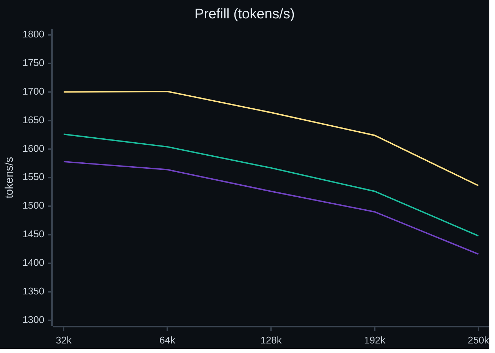
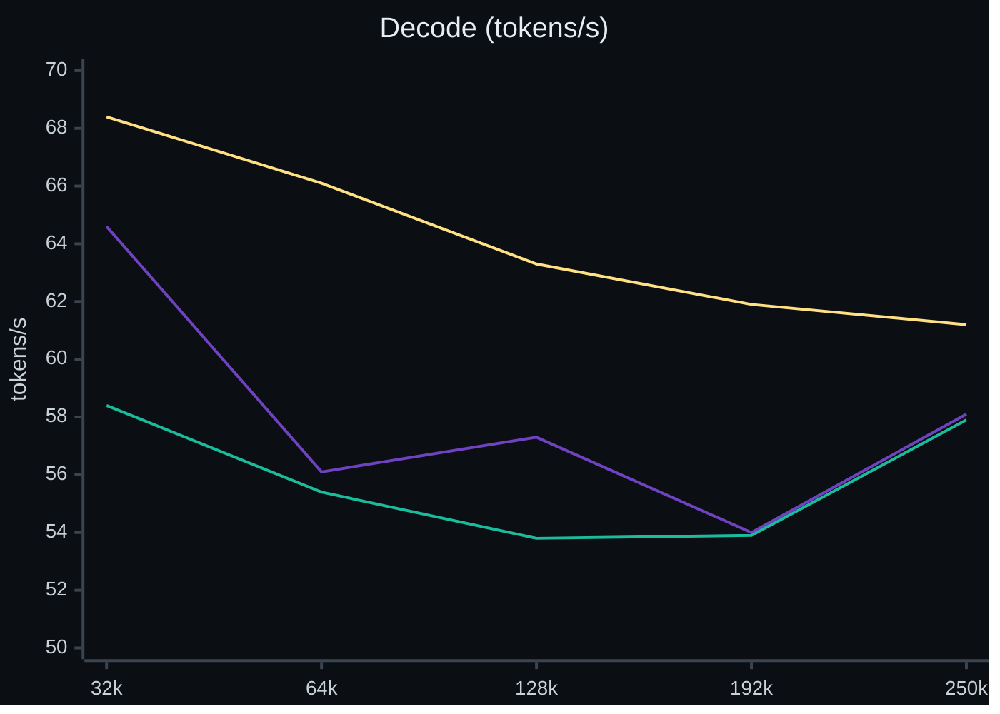

# Crucible

An inference engine for EXL3 checkpoints of Qwen3.8-Flash-Next on one AMD Strix Halo APU. It gives exact output and fast long-context agent work.

Crucible runs **EXL3** checkpoints of **Qwen3.8-Flash-Next** on **AMD Strix Halo**: one **Ryzen AI Max+ 395** with a
**Radeon 8060S** (**gfx1151**) and 128 GB of unified memory. It uses its own **ROCm/HIP** kernels in C++20 and no other
engine. A local OpenAI-compatible server gives chat, streaming, function calls and exact speculative decoding. This is
research software for one GPU architecture. It is not a general model backend or a production service.

[How it got fast](docs/how-it-got-fast.md) · [Results](docs/RESULTS.md) · [Rivals](docs/RIVALS.md) ·
[Quality](docs/QUALITY.md) · [Changelog](CHANGELOG.md) · [Architecture](docs/ARCHITECTURE.md) · [Build guide](docs/BUILD.md)

## Speed of this release

Release v0.30.0. Measured Oct 31, 2026 on the build of this release, balanced power profile (GPU clock about 2.30 to 2.33 GHz).
Each value is the median of 2 runs. The server ran 4 sessions of 262,144 tokens with image input and speculative decoding (MTP)
on, as in daily use, with prefill launches of 8,192 rows (`CRUCIBLE_PF_LAUNCH_ROWS=8192+128`). Every row uses prompts that no
cache has seen, except the re-send row. The v0.26.0 and v0.22.0 columns are earlier releases, measured with the same tool (run
series of Oct 27 to 28, 2026). What changed since v0.26.1 is in the [Changelog](CHANGELOG.md).

**4.05 bpw pack (the higher-quality option)**

| Row | v0.30.0 | v0.26.0 | v0.22.0 |
|---|---:|---:|---:|
| Cold prompt, 32K: first token (s) | 17.9 | 19.4 | 19.7 |
| Cold prompt, 32K: prefill (tok/s) | 1,741 | 1,613 | 1,585 |
| Cold prompt, 130K: first token (s) | 77.3 | 82.0 | 84.5 |
| Cold prompt, 130K: prefill (tok/s) | 1,669 | 1,574 | 1,527 |
| Same 32K prompt sent again: first token (s) | 0.023 | 0.014 | 1.870 |
| Decode at 32K, 1 session, code, paired run (tok/s) | 68.4 | 58.4 (2 low samples) | 64.6 |
| Decode at 32K, 1 session, prose (tok/s) | 53.3 | 50.5 | 50.4 |
| Decode, 4 sessions, total (tok/s) | 102.4 | 106.9 | 106.7 |
| Serial decode, no speculation, short context (tok/s) | 34.3 | 32.1 | 31.0 |

**3.05 bpw pack (the faster option)**

| Row | v0.30.0 | v0.26.0 | v0.22.0 |
|---|---:|---:|---:|
| Cold prompt, 32K: first token (s) | 16.9 | 18.9 | 18.9 |
| Cold prompt, 32K: prefill (tok/s) | 1,845 | 1,652 | 1,652 |
| Cold prompt, 130K: first token (s) | 74.2 | 81.3 | 81.0 |
| Cold prompt, 130K: prefill (tok/s) | 1,738 | 1,587 | 1,593 |
| Same 32K prompt sent again: first token (s) | 0.020 | 0.021 | 1.736 |
| Decode at 32K, 1 session, code (tok/s) | 70.1 † | 75.4 † | 70.6 † |
| Decode at 32K, 1 session, prose (tok/s) | 61.5 † | 59.2 † | 58.3 † |
| Decode, 4 sessions, total (tok/s) | 129.3 † | 133.1 † | 131.1 † |
| Serial decode, no speculation, short context (tok/s) | 39.4 | 36.2 | 35.4 |

† These values used a tuned draft head file that is not part of the release, so you cannot repeat them with the public files. The v0.30.0 column used it too, so the decode rows of the 3.05 pack compare with each other only.

Two runs per cell is a small sample. Decode with 1 session changes between runs and between prompts, because the draft head
predicts some text better than other text. In the run series of Oct 27 to 28, 11 builds span 60.5 to 66.9 tok/s on the 4.05 code
row, so a difference of that size in the decode rows is not a result. The cold prefill rows and the re-send row move less.
The 4.05 code row comes from the decode chart (v0.22.0 and v0.26.0 Oct 29, v0.30.0 Oct 31); the ladder gives 64.5 against 65.8 tok/s for it.
Against v0.26.0 (same tool and prompts; v0.26.0 measured Oct 28 to 29, v0.30.0 on Oct 31), v0.30.0 prefills 5% to 6% faster on the
4.05 pack and 8% to 11% faster on the 3.05 pack (8% to 9% against v0.26.0 measured the same night), at every length from 32K to 250K.
It decodes 6% to 8% faster on the 4.05 pack from 64K to 250K, and 7% faster at 32K (run 2; v0.26.0 read low in run 1, which makes it 20%).
On the 3.05 pack, decode is about equal (-2% to +1% against v0.26.0 measured the same night; 70.1 against 74.2 tok/s on the code row of
that night); both builds used the draft head file †. Decode with 4 sessions on the 4.05 pack reads 4% lower than v0.26.0 in the table
above (102.4 against 106.9 tok/s; the two runs gave 98.3 and 106.6), and v0.26.0 moved 5% between nights on the 3.05 pack (133.1 † and 126.0 † tok/s). We have not found a cause. All values use the balanced power profile; the performance profile gives other prefill rates
([Rivals](docs/RIVALS.md#the-power-profile-run-of-oct-26-2026)). More data, the method and the older tables are in
[Results](docs/RESULTS.md).

**Prefill by context length, 4.05 bpw pack** (tokens per second, median of 4 runs per point for v0.22.0 and v0.26.0, run of Oct 28 to 29;
2 runs per point for v0.30.0, run of Oct 31, 2026). Lines: v0.22.0 purple, v0.26.0 teal, v0.30.0 yellow.



**Decode by context length, 4.05 bpw pack** (tokens per second, median of up to 4 samples for v0.22.0 and v0.26.0, up to 6 for v0.30.0; v0.22.0 and v0.26.0 from the run of
Oct 29, 2026, v0.30.0 from the run of Oct 31, 2026; v0.22.0 purple, v0.26.0 teal, v0.30.0 yellow).



All 3 builds got the same prompts. On the same prompts and the same reply text, v0.30.0 decodes 1.06 to 1.08 times as fast as v0.26.0 from 64K to 250K, and 1.07 times at 32K in run 2 (1.20 with run 1, in which v0.26.0 read low). The v0.30.0 line holds up to 6 samples per point; the other two hold up to 4. v0.26.0 read low in run 1 at 32K (47.2 and 51.6 tok/s, the others 62.9
to 64.7); the cause is not found. The third question of each unit of the run of Oct 29 was invalid (a 10-token reply, no decode
number). The 3.05 chart and the data are in [Results](docs/RESULTS.md#decode-by-context-length).

## How it compares

Our own measurements of Halogen 0.18.14 and Gufo 0.22.0 on the same machine, with the same prompts and client, Oct 23 to 26,
2026. The GPU clock was similar; in the prefill rows Halogen ran about 3% higher. Each value is the median of 2 rounds. Each
Crucible value is the 4.05 pack and the Crucible build of that date (v0.26.0 or a build of Oct 25), older than v0.30.0. Bold marks the fastest.

| Row | Halogen 0.18.14 | Gufo 0.22.0 | Crucible, same run | Measured |
|---|---:|---:|---:|---|
| Serial decode, no speculation, short context (tok/s) | **42.2** | 29.3 | 32.2 | Oct 23 to 24 |
| Decode, mixed text, 1 session, speculation (tok/s) | **75.0** | 45.2 | 62.3 | Oct 23 to 24 |
| Decode, 4 sessions at 32K, total (tok/s) | 96.5 | 90.4 | **111.4** | Oct 23 to 24 |
| Cold prefill, 32K, balanced power profile (tok/s) | **1,938** | 1,693 | 1,614 | Oct 23 to 24 |
| Cold prefill, 32K, performance power profile (tok/s), Crucible build of Oct 25 | **2,121** | 1,843 | 1,870 | Oct 26 |

Halogen leads one-session decode and cold prefill at equal bits. It stores the layers that mix the hidden streams in 6 bits, and
its pack has 4.16 bits per weight. Crucible leads with 4 and 8 sessions. At equal bits (4.05), Halogen also leads decode with speculation on code (104.9 against 89.1 tok/s). The 3.05 pack has a lower KL divergence than the pack of Halogen (see below). All rows, dates, packs and the method are in [Rivals](docs/RIVALS.md). Newer versions exist (Halogen 0.18.18, Gufo v0.27.0, both Oct 29, 2026); we measured neither, and we did not measure the rival values again for v0.30.0. Thank you to the authors of Halogen and Gufo: their engines made this comparison possible.

## Why Crucible

- **The output is exact.** Speculative decoding changes the speed, not the tokens: the target model checks every draft token, and
  only checked tokens commit. Batching, load and speculation depth do not change the tokens. Each speed change must give
  byte-identical tokens on a fixed gate set before it merges ([exactness rules](docs/ARCHITECTURE.md#exactness-rules)).
  [Session replay](docs/SESSION_REPLAY.md) lists the cases in which a cache resume gives other tokens than a cold prompt.
- **Quality per bit.** KL divergence from the 16-bit (BF16) model, on 896 text positions, scored by us on Oct 24 to 25, 2026 (lower is closer). Gufo 0.22.0
  returned no log-probabilities, so it has no row (v0.27.0 serves them; not scored). [Quality](docs/QUALITY.md) has older tables.

| Engine and pack | Bits per weight | KL from BF16 | Same top token as BF16 |
|---|---:|---:|---:|
| Crucible 4.05 | 4.05 | **0.0230** | **94.3%** |
| Crucible 3.05 | 3.05 | 0.0513 | 91.7% |
| Halogen 0.18.14 | 4.16 | 0.0648 | 90.3% |

- **The conversation cache.** A later turn pays only for its new tokens. Sending the same 32K prompt again gives the first token
  after 0.023 s instead of 1.87 s in v0.22.0 (v0.26.0: 0.014 s; 4.05 pack). An optional disk tier keeps conversations
  across a restart.

## Quick start

### Build

```sh
make   # needs the software under "Requirements"; writes build/engine/crucible
# if make stops with "argument facts drift" on another ROCm, run: make SPLIT_CHECK=0
```

### Download a model

Read the [model license note](#licenses) first. Keep every tokenizer file, weight shard, n-gram table and MTP mixer patch of the pack
([all packs](https://huggingface.co/turboderp/Qwen3.8-Flash-Next-exl3)). The 3.05 payload alone is about 84.45 GB.

```sh
PACK=3.05bpw_h5_ng5   # or 4.05bpw_h6_ng6, the higher-quality pack
CKPT="$PWD/models/Qwen3.8-Flash-Next-exl3-$PACK"
hf download turboderp/Qwen3.8-Flash-Next-exl3 --revision "$PACK" --local-dir "$CKPT"
```

### Run

```sh
python -m server "$CKPT" --engine build/engine/crucible --ctx 32768
curl -sS http://127.0.0.1:8790/v1/chat/completions -H 'Content-Type: application/json' \
  -d '{"model":"crucible","messages":[{"role":"user","content":"Say hello."}],"temperature":0,"max_tokens":32}'
```

With 4 sessions of 262K tokens and `--vision` on the 4.05 pack, set `CRUCIBLE_PF_LAUNCH_ROWS=8192+128`. The default (16384+128) grows the stage arena from 2,346 to 4,656 MiB.

**Security.** The server binds to `127.0.0.1:8790`. `--host ADDRESS` selects another address and prints a warning when it is not
loopback. The server has no authentication and no TLS. Do not expose it to a network.

The API provides `/v1/chat/completions`, `/v1/completions`, `/v1/models` and `/tokenize`. Use `stream: true` for server-sent events
and OpenAI `tools` definitions for function calls ([server guide](server/README.md), [OpenAI clients](docs/OPENAI_CLIENTS.md)).

### Requirements

Ryzen AI Max+ 395, Radeon 8060S (gfx1151), 128 GB shared LPDDR5X-8000; Linux (tested: Arch Linux with kernel 7.2.7 and ROCm 7.2.4); a C++20 HIP compiler, GNU Make and POSIX threads; Python 3.12 or newer
(`requirements-cpu.txt`); disk space for one checkpoint and the build. Set `CRUCIBLE_PLE_HOST=1` to keep the n-gram table in host
memory (32.6 GB at 3.05, 39.0 GB at 4.05). The CPU tests run with `make -j2 test-cpu` and need no GPU ([all targets](docs/BUILD.md)).

## Features

- Exact speculative decoding with the model's draft head, and a keyed sampling law: a seeded request gives the same tokens at any speculation depth ([how](docs/how-it-got-fast.md#3-guess-ahead-and-check)).
- Local OpenAI-compatible server: chat, streaming, tools, up to 8 sessions on one engine ([server guide](server/README.md)).
- Conversation cache with an optional disk tier (`--state-dir`) ([session replay](docs/SESSION_REPLAY.md)).
- Image input, opt-in with `--vision`. No video.
- EXL3 packs from 2.18 to 4.18 bits per weight load. The qualified packs are 3.05 and 4.05 ([changelog](CHANGELOG.md)).
- Opt-in 16-bit n-gram table, built with one command ([NGRAM16](docs/NGRAM16.md)).
- Update by hand with `make update`, with a rollback; an optional timer ([Updates](#updates)).
- Hardware ceilings measured on the chip, and each speed claim names its ceiling ([calibration](docs/CALIBRATION.md)).

## Roadmap

In priority order. Each item moves only when a measured row moves.

1. More accepted tokens for each weight pass: a better draft head for prose and chat, and verify passes that cost close to a serial step.
2. Single-session decode: fewer bytes read for each token and fewer gaps between kernels. Serial decode uses 70% to 77% of the measured memory bandwidth (Oct 22 audit).
3. Cold prefill: the MoE matrix products, and cold prompts launched in pairs. Cold prefill is at 53% to 56% of the estimated WMMA ceiling (Oct 22 audit).
4. Quality per bit: more packs, mixed precision, the 16-bit n-gram table as a default if it pays.
5. Serving: cache memory, the disk tier, and a shared prompt start between sessions.

## Updates

Releases are numbered `v0.<train>.<fix>`; the notes are in [CHANGELOG.md](CHANGELOG.md) and on the Releases page. The server
shows its version at start. Once in 24 hours it asks GitHub if a newer release exists (one plain request, nothing else, no change
to your files). Turn this off with `CRUCIBLE_NO_UPDATE_CHECK=1` or `--no-update-check`. `make update` builds the newest release and runs a
short self-test; it restores the previous release when a step fails. `make rollback` undoes one update. Automatic updates are off
by default. The commands, the timer and the details are in [UPDATES](docs/UPDATES.md).

## Documentation

- [How it got fast](docs/how-it-got-fast.md): the six ideas behind the numbers, in plain words.
- [Results](docs/RESULTS.md): release data, method, hardware limits, history. [Benchmark suite](docs/BENCHMARKS.md).
- [Rivals](docs/RIVALS.md) and [Quality](docs/QUALITY.md). [Changelog](CHANGELOG.md).
- [Measurement details](docs/RESULTS.md#measurement-details) and [hardware limits](docs/CALIBRATION.md).
- [Architecture](docs/ARCHITECTURE.md), [forward specification](docs/FLASHNEXT_FORWARD.md), [EXL3 format](docs/EXL3_FORMAT.md), [build guide](docs/BUILD.md).
- [Third-party terms](docs/THIRD_PARTY.md). Progress report: [https://srv.jaedyn.me/strix-halo-engine-optimization/index.html](https://srv.jaedyn.me/strix-halo-engine-optimization/index.html).

Limits: only the named packs and gfx1151 are qualified. The server has no authentication and no tenant isolation. The conversation
cache is opt-in and sits in host memory unless the disk tier is on. Generated tool arguments can be invalid: the server reports the
error and never runs a tool. A long-context timing is not a quality test.

## Licenses

The engine uses Apache-2.0 ([LICENSE](LICENSE), [NOTICE](NOTICE); the ExLlamaV3 notice is in `NOTICE`). **The model weights use
other terms.** Both supported EXL3 packs use the Qwen Community License 1.0, and commercial use has additional conditions. Read
[the model license note](docs/THIRD_PARTY.md#model-weights) before you download or use a pack. This repository does not include the weights.
