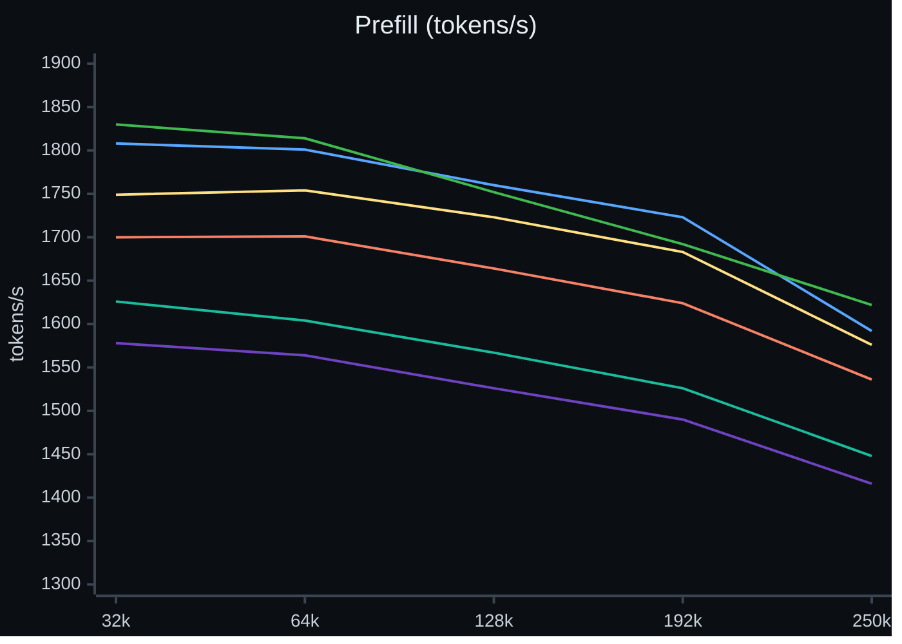
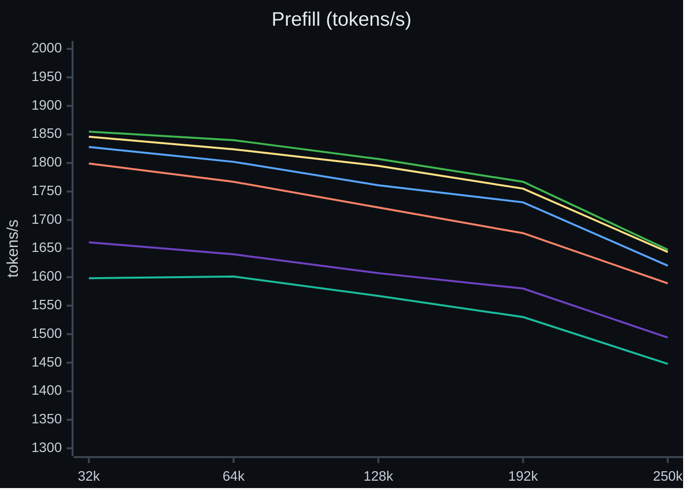
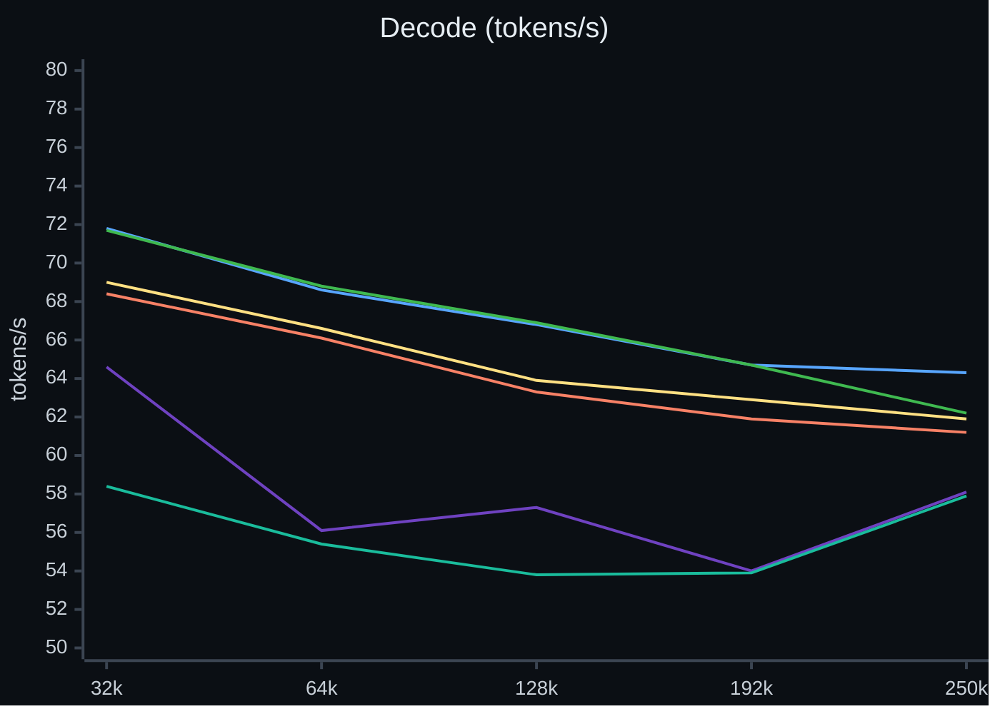
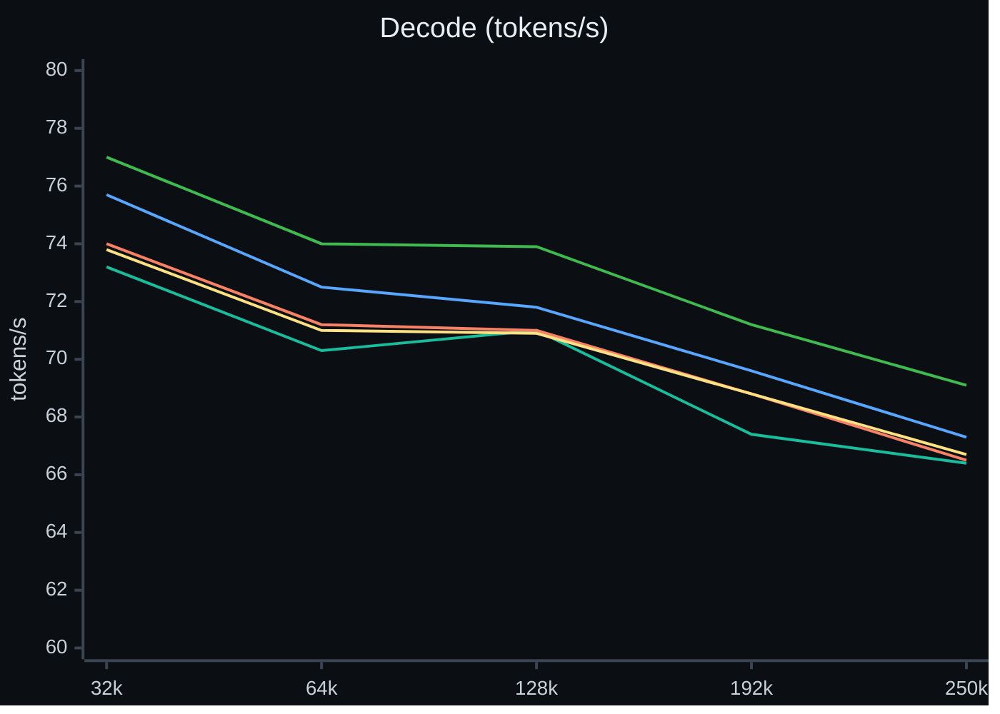

# Results

Measured speed of Crucible on one AMD Strix Halo machine. This page has the data behind the tables in the
[README](../README.md), the method of each run, the hardware limits and a dated history of the earlier tables.
The comparison with other engines is in [Rivals](RIVALS.md). Quality is in [Quality](QUALITY.md).
The ideas behind the numbers are in [How it got fast](how-it-got-fast.md).

Contents: [release ladder](#release-ladder) · [prefill by context length](#prefill-by-context-length) ·
[decode by context length](#decode-by-context-length) · [hardware ceilings](#hardware-ceilings) ·
[earlier releases](#earlier-releases) ·
[measurement details](#measurement-details) · [history of earlier tables](#history-of-earlier-tables)

## Release ladder

One harness measured 11 builds, from Oct 8 to Oct 26, 2026, in a run series of Oct 27 to 28, 2026, the build of v0.30.0 (Oct 30) on Oct 31, 2026, the build of v0.31.0 (Oct 31) on Nov 1 to 2, 2026, and the builds of v0.32.0 (Oct 31) and v0.33.0 (Nov 2) on Nov 3, 2026, with the same harness. Each build ran with the
server settings of its own time. The harness, the prompts and the rows are the same for all builds. Each value is the median
of 2 runs. The GPU clock is the median of the runs (balanced power profile). Most builds are internal builds without a
public release. A build without a Crucible release number is listed by its commit date.

**4.05 bpw pack**

| Build date | Public release | Cold 32K first token (s) | Cold 32K prefill (tok/s) | Cold 130K first token (s) | Cold 130K prefill (tok/s) | Re-send 32K first token (s) | Decode 32K code (tok/s) | Decode 32K prose (tok/s) | Decode 4 sessions (tok/s) | Serial decode (tok/s) | GPU clock (MHz) |
|---|---|---:|---:|---:|---:|---:|---:|---:|---:|---:|---:|
| Oct 8 | none | 21.4 | 1,458 | 91.3 | 1,412 | 2.025 | 64.2 | 50.7 | 101.0 | 31.0 | 2,347 |
| Oct 9 | none | 21.6 | 1,449 | 93.0 | 1,388 | 2.026 | 64.3 | 51.8 | 111.0 | 30.9 | 2,353 |
| Oct 11 | none | 20.8 | 1,500 | 89.0 | 1,449 | 1.975 | 60.8 | 50.2 | 110.2 | 30.9 | 2,325 |
| Oct 13 | none | 19.9 | 1,571 | 84.7 | 1,523 | 1.885 | 60.6 | 47.2 | 111.0 | 30.8 | 2,330 |
| Oct 14 | none | 19.8 | 1,580 | 84.3 | 1,530 | 1.887 | 66.9 | 49.3 | 110.3 | 30.9 | 2,333 |
| Oct 17 | v0.22.0 to v0.22.4 | 19.7 | 1,585 | 84.5 | 1,527 | 1.870 | 65.8 | 50.4 | 106.7 | 31.0 | 2,333 |
| Oct 20 | none | 19.6 | 1,590 | 83.7 | 1,542 | 1.865 | 65.1 | 50.4 | 111.3 | 30.9 | 2,329 |
| Oct 22 | none | 18.9 | 1,648 | 81.7 | 1,580 | 1.792 | 62.1 | 49.1 | 113.1 | 31.1 | 2,324 |
| Oct 23 | none | 19.1 | 1,639 | 82.3 | 1,568 | 0.014 | 64.6 | 50.9 | 112.5 | 31.2 | 2,328 |
| Oct 23 | v0.26.0, v0.26.1 | 19.4 | 1,613 | 82.0 | 1,574 | 0.014 | 65.8 | 50.5 | 106.9 | 32.1 | 2,326 |
| Oct 26 | none (after v0.26.1) | 18.0 | 1,737 | 77.4 | 1,667 | 0.017 | 60.5 | 53.8 | 112.1 | 34.1 | 2,339 |
| Oct 30 | v0.30.0 | 17.9 | 1,741 | 77.3 | 1,669 | 0.023 | 64.5 | 53.3 | 102.4 | 34.3 | 2,326 |
| Oct 31 | v0.31.0 | 17.7 | 1,763 | 75.6 | 1,707 | 0.021 | 67.1 | 55.2 | 117.6 | 34.1 | 2,318 |
| Oct 31 | v0.32.0 | 17.0 | 1,841 | 74.3 | 1,736 | 0.021 | 66.0 | 57.6 | n/a | 34.2 | 2,300 |
| Nov 2 | v0.33.0 | 16.9 | 1,851 | 72.1 | 1,789 | 0.020 | 71.2 | 56.3 | 113.8 | 34.1 | 2,295 |

**3.05 bpw pack**

| Build date | Public release | Cold 32K first token (s) | Cold 32K prefill (tok/s) | Cold 130K first token (s) | Cold 130K prefill (tok/s) | Re-send 32K first token (s) | Decode 32K code (tok/s) | Decode 32K prose (tok/s) | Decode 4 sessions (tok/s) | Serial decode (tok/s) | GPU clock (MHz) |
|---|---|---:|---:|---:|---:|---:|---:|---:|---:|---:|---:|
| Oct 8 | none | 20.7 | 1,512 | 88.3 | 1,461 | 1.934 | 70.2 | 58.6 | 122.3 | 35.4 | 2,332 |
| Oct 9 | none | 20.5 | 1,523 | 87.6 | 1,472 | 1.921 | 73.3 | 58.0 | 132.0 | 35.4 | 2,326 |
| Oct 11 | none | 20.1 | 1,555 | 85.9 | 1,502 | 1.884 | 70.5 | 58.4 | 129.6 | 35.3 | 2,313 |
| Oct 13 | none | 19.3 | 1,615 | 82.6 | 1,561 | 1.808 | 76.8 | 59.4 | 127.1 | 35.1 | 2,320 |
| Oct 14 | none | 18.7 | 1,666 | 80.7 | 1,600 | 1.735 | 73.2 | 59.0 | 132.4 | 35.3 | 2,313 |
| Oct 17 | v0.22.0 to v0.22.4 | 18.9 | 1,652 | 81.0 | 1,593 | 1.736 | 70.6 | 58.3 | 131.1 | 35.4 | 2,323 |
| Oct 20 | none | 18.8 | 1,666 | 80.2 | 1,609 | 1.727 | 74.0 | 58.4 | 132.4 | 35.5 | 2,315 |
| Oct 22 | none | 19.0 | 1,643 | 81.3 | 1,586 | 1.729 | 72.7 | 58.1 | 130.7 | 35.4 | 2,325 |
| Oct 23 | none | 19.0 | 1,644 | 81.7 | 1,579 | 0.021 | 74.5 | 57.3 | 128.1 | 35.4 | 2,321 |
| Oct 23 | v0.26.0, v0.26.1 | 18.9 | 1,652 | 81.3 | 1,587 | 0.021 | 75.4 | 59.2 | 133.1 | 36.2 | 2,332 |
| Oct 26 | none (after v0.26.1) | 17.4 | 1,793 | 81.7 | 1,579 | 0.014 | 74.8 | 61.0 | 130.8 | 39.1 | 2,316 |
| Oct 30 | v0.30.0 | 16.9 | 1,845 | 74.2 | 1,738 | 0.020 | 70.1 † | 61.5 † | 129.3 † | 39.4 | 2,300 |
| Oct 23 | v0.26.0, v0.26.1 (measured the same night as v0.30.0) † | 18.9 | 1,650 | 81.5 | 1,582 | 0.017 | 74.2 † | 60.7 † | 126.0 † | 36.4 | 2,329 |
| Oct 31 | v0.31.0 | 16.8 | 1,858 | 72.8 | 1,771 | 0.017 | 75.4 | 57.2 | 128.1 | 39.2 | 2,295 |
| Oct 30 | v0.30.0 (measured the same night as v0.31.0) | 16.9 | 1,843 | 74.2 | 1,739 | 0.017 | 76.7 | 59.4 | 127.2 | 39.5 | 2,299 |
| Oct 23 | v0.26.0, v0.26.1 (measured the same night as v0.31.0) | 19.2 | 1,628 | 81.5 | 1,583 | 0.025 | 70.8 | 58.4 | 125.8 | 36.5 | 2,323 |
| Oct 17 | v0.22.0 to v0.22.4 (measured the same night as v0.31.0) | 18.9 | 1,656 | 81.0 | 1,594 | 1.736 | 71.5 | 56.3 | 128.3 | 35.4 | 2,320 |
| Oct 31 | v0.32.0 | 16.7 | 1,867 | 72.4 | 1,783 | 0.023 | 74.0 | 58.9 | 130.2 (1 run) | 39.3 | 2,290 |
| Nov 2 | v0.33.0 | 16.7 | 1,870 | 71.3 | 1,809 | 0.020 | 73.9 | 60.3 | 118.3 | 39.3 | 2,289 |

† In the 3.05 table, the builds from Oct 9 to Oct 26, the row of v0.30.0 and the row of v0.26.0 measured on Oct 31 all ran with a tuned draft head file that is not part of any release. Compare their decode columns with each other only. With the public files, decode values can differ. The rows of Nov 1 to 3 (v0.31.0, v0.32.0, v0.33.0 and the older builds measured on the same nights) ran with the public files only: the tool stops a run if the server log shows a draft head file (`mtp sidecar:`).

The v0.32.0 row (the run of Nov 3) has no 4-session value on the 4.05 pack: one session of each run stopped after 13 tokens. On the 3.05 pack that value is from one run: one session of the second run stopped after 5 tokens.

Notes:

- The ladder rows of v0.32.0 and v0.33.0 ran Nov 3, 2026 on their own builds, with the public files and no tuned draft head file. Both set `CRUCIBLE_DRAFT_HEAD=q2`, `CRUCIBLE_DRAFT_CHAIN=hc8,lead`, `CRUCIBLE_PLE_HOST=1`, `CRUCIBLE_COMPACT_STATE=1` and `CRUCIBLE_PF_LAUNCH_ROWS=16384+128`; the v0.33.0 rows also set `CRUCIBLE_PLE_FETCH=1`. The rows above them did not set the first two words (see the [Changelog](../CHANGELOG.md)).
- The ladder run of Nov 3, 2026 (v0.33.0) gave a valid result for 2 of 2 pack and build pairs (a pair is valid when all of its runs are valid, with no error and no give-up). The GPU clock of the pairs is 2,289 to 2,295 MHz. The v0.32.0 row gave a valid result for 2 of 2 pairs; its GPU clock is 2,290 to 2,300 MHz.
- The 4-session value of v0.32.0 on the 4.05 pack is missing: one session of each run stopped after 13 tokens. On the 3.05 pack one session of the second run stopped after 5 tokens, so the value is from one run. The 4-session value of v0.33.0 is the mean of two runs: 106.3 and 121.4 tok/s on the 4.05 pack, 127.9 and 108.8 tok/s on the 3.05 pack. That row has a wide spread.
- The ladder run of Nov 1 to 2 (v0.31.0) gave a valid result for 5 of 5 pack and build pairs (a pair is valid when all of its runs are valid, with no error and no give-up). The GPU clock of the pairs is 2,295 to 2,323 MHz.
- All 22 pack and build pairs of the run series of Oct 27 to 28 gave a valid result. The harness recorded no error and no give-up.
  The run of Oct 31 gave a valid result for all 3 pack and build pairs (v0.30.0 on both packs, v0.26.0 on the 3.05 pack). Each pair has 2 of 2 valid runs, no error, no give-up, and a GPU clock of 2,300 to 2,333 MHz.
- The v0.26.0 row of Oct 31 (3.05 pack) is the build of the row of Oct 23, measured the same night as v0.30.0 with the same tool and the same draft head file †. Cold 32K prefill is 1,845 tok/s for v0.30.0 against 1,650 tok/s for v0.26.0. Decode at 32K, code, is 70.1 against 74.2 tok/s; a paired run of the same night (see [decode by context length](#decode-by-context-length)) gives 0.98 to 1.01 for v0.30.0 against v0.26.0, so decode on this pack is about equal.
- Decode with 4 sessions on the 4.05 pack is 102.4 tok/s for v0.30.0 against 106.9 tok/s for v0.26.0 (row of Oct 23), 4% lower. The two runs of v0.30.0 gave 98.3 and 106.6 tok/s. We have not found a cause and we do not claim a change.
- The GPU clock is within 1.5% for all builds of a pack (the v0.30.0 row: 2,326 and 2,300 MHz), so the clock does not explain the differences.
- Two runs per value is a small sample. Decode with 1 session changes between runs and between prompts, because the draft head
  predicts some text better than other text. On the 4.05 code row, the 11 builds span 60.5 to 66.9 tok/s. A difference of that
  size is not a result. Cold prefill and the re-send row move less.
- The 3.05 build of Oct 26 uses the server settings of the build of Oct 23, because no 3.05 profile existed for it.
- Cold prefill at 32K on the 4.05 pack went from 1,458 tok/s (Oct 8 build) to 1,737 tok/s (Oct 26 build) and to 1,741 tok/s (v0.30.0). The v0.30.0 run uses prefill launches of 8,192 rows
  (`CRUCIBLE_PF_LAUNCH_ROWS=8192+128`), as the earlier rows do. The default of the v0.30.0 engine is 16,384 rows; see the [Changelog](../CHANGELOG.md).
  The first token of a re-sent 32K prompt went from 1.8 to 2.0 s (builds before Oct 23) to 0.014 to 0.021 s (builds from Oct 23). The conversation
  cache of those builds restores a prompt that it holds in full.
- The build of Oct 26 reads lower than the build of Oct 23 on the 4.05 code decode row at 32K (60.5 against 65.8 tok/s). The paired run of Oct 29
  answers it: the build of Oct 26 decodes 65.3 tok/s at 32K (4 samples), v0.26.0 58.4 and v0.22.0 64.6. The reply text and the tokens per verify pass are equal, and two low samples of v0.26.0 explain its median. The ladder row is a single run of a different prompt. See [decode by context length](#decode-by-context-length).

## Prefill by context length

Cold prompts of 32K to 250K tokens, one request at a time, through the server in the daily layout (4 sessions of 262,144
tokens, image input on). Each point is the median of 4 runs (v0.22.0 and v0.26.0, measured Oct 28 to 29, 2026) or of 2 runs (v0.30.0, measured Oct 31, 2026, v0.31.0, measured Nov 1 to 2, 2026, and v0.32.0 and v0.33.0, measured Nov 3, 2026). Every run has its own first line, so no cache has seen the prompt.
Lines: v0.22.0 purple, v0.26.0 teal, v0.30.0 orange, v0.31.0 yellow, v0.32.0 blue, v0.33.0 green. On the 3.05 pack the lines of v0.26.0 and v0.30.0 are from Nov 1 to 2 (v0.30.0 on Nov 1), the line of v0.31.0 is from the repeat of the morning of Nov 2 (see the notes under [Decode by context length](#decode-by-context-length)), the lines of v0.32.0 and v0.33.0 are from Nov 3, and the line of v0.22.0 is from Oct 28 to 29 (prefill does not use the draft head file). The v0.32.0 and v0.33.0 lines set `CRUCIBLE_DRAFT_HEAD=q2`, `CRUCIBLE_DRAFT_CHAIN=hc8,lead` and `CRUCIBLE_PF_LAUNCH_ROWS=16384+128`; the v0.33.0 lines also set `CRUCIBLE_PLE_FETCH=1`; the other lines did not set the first two, and the 4.05 lines of the other builds used 8,192 launch rows.

**4.05 bpw pack**

**3.05 bpw pack**

| Pack | Build | 32k | 64k | 128k | 192k | 250k |
|---|---|---:|---:|---:|---:|---:|
| 4.05 | v0.22.0 | 1,578 | 1,564 | 1,526 | 1,490 | 1,416 |
| 4.05 | v0.26.0 | 1,626 | 1,604 | 1,567 | 1,526 | 1,448 |
| 4.05 | v0.30.0 | 1,700 | 1,701 | 1,664 | 1,624 | 1,536 |
| 4.05 | v0.31.0 | 1,749 | 1,754 | 1,723 | 1,683 | 1,576 |
| 4.05 | v0.32.0 | 1,808 | 1,801 | 1,760 | 1,723 | 1,592 |
| 4.05 | v0.33.0 | 1,830 | 1,814 | 1,752 | 1,692 | 1,622 |
| 3.05 | v0.22.0 | 1,661 | 1,640 | 1,607 | 1,580 | 1,494 |
| 3.05 | v0.26.0 | 1,598 | 1,601 | 1,567 | 1,530 | 1,448 |
| 3.05 | v0.30.0 | 1,799 | 1,767 | 1,722 | 1,677 | 1,589 |
| 3.05 | v0.31.0 | 1,846 | 1,824 | 1,795 | 1,755 | 1,644 |
| 3.05 | v0.32.0 | 1,828 | 1,802 | 1,761 | 1,731 | 1,620 |
| 3.05 | v0.33.0 | 1,855 | 1,840 | 1,807 | 1,767 | 1,648 |

Prefill falls 9% to 12% from 32K to 250K on v0.22.0, v0.26.0 and v0.30.0, and 10% on the 4.05 pack and 11% on the 3.05 pack for v0.31.0, 12% on the 4.05 pack and 11% on the 3.05 pack for v0.32.0, and 11% on both packs for v0.33.0. The 4 runs of one point of v0.22.0 and v0.26.0 differ by 2% or less on the 4.05 pack; the 2 runs of v0.30.0 differ by 2.2% or less (4.05 at 32K: 1,681 and 1,718).
On the 3.05 pack they differ by 5% or less, except one low run (1,379 tok/s, v0.26.0 at 64K). The median ignores it.

The ranges against v0.32.0 in the README use these values of v0.32.0 (32K to 250K; both packs measured Nov 3, 2026): prefill on the 4.05 pack 1,808, 1,801, 1,760, 1,723, 1,592 tok/s, on the 3.05 pack 1,828, 1,802, 1,761, 1,731, 1,620 tok/s.

## Decode by context length

One request at a time, through the server in the daily layout (4 sessions of 262,144 tokens, image input on, speculative decoding on,
balanced power profile). Each unit is one context of 32K to 250K tokens in one run: a cold prompt (content 1), then a new question on the same context
(content 2; the cache holds the context). Every build got the same prompts and the same questions (the first line holds the run and the
depth, never the build). One sample is one reply of 512 tokens; decode tok/s = (completion tokens - 1) / (last chunk time - first chunk time).
2 runs per build and depth. v0.22.0 and v0.26.0 were measured Oct 29, 2026 (4.05 from 17:04, 3.05 until 22:52); v0.30.0 was measured Oct 31, 2026; v0.31.0 was measured Nov 1, 2026 on the 4.05 pack and on the morning of Nov 2 on the 3.05 pack (a repeat, see the notes below); the 3.05 lines of v0.26.0 and v0.30.0 were measured Nov 1 to 2 (v0.30.0 on Nov 1; public files, no tuned draft head file); v0.32.0 and v0.33.0 were measured Nov 3, 2026 on both packs (public files, no tuned draft head file; the options `CRUCIBLE_DRAFT_HEAD=q2` and `CRUCIBLE_DRAFT_CHAIN=hc8,lead` and 16,384 launch rows set; v0.33.0 also set `CRUCIBLE_PLE_FETCH=1`).
Lines: v0.22.0 purple, v0.26.0 teal, v0.30.0 orange, v0.31.0 yellow, v0.32.0 blue, v0.33.0 green.

For v0.22.0 and v0.26.0 (run of Oct 29), a third question in each unit gave a 10-token reply, so it is invalid and gave no decode number. Every point of these two builds has at most 4 samples
(2 runs x 2 questions). Replies that ended early (341 or 485 tokens on the 4.05 pack, 10 tokens twice on the 3.05 pack) and requests without a clock sample
(13 of 30 second questions on the 3.05 pack, at 32K, 64K and some at 192K) are dropped, so those points have fewer samples.
For v0.30.0 (run of Oct 31), the third question gave a valid reply in all units, so a point has at most 6 samples (2 runs x 3 questions). A short reply (10 tokens) was dropped:
2 of 30 requests on the 4.05 pack and 6 of 30 on the 3.05 pack. The runs of v0.31.0 and the v0.30.0 run of Nov 1 dropped the same number of requests (2 of 30 on the 4.05 pack, 6 of 30 on the 3.05 pack). The v0.32.0 and v0.33.0 runs dropped the same number of requests by the same rule (2 of 30 on the 4.05 pack, 6 of 30 on the 3.05 pack, all short replies); the n of each point says how many samples remain. No request lacked a clock sample. The ratios below use only the questions that both builds answered.

**4.05 bpw pack**

**3.05 bpw pack** (public files, no tuned draft head file; there is no v0.22.0 line, because its 3.05 run of Oct 29 used the tuned file)

Median decode tok/s (n = samples in the median):

| Pack | Build | 32k | 64k | 128k | 192k | 250k |
|---|---|---:|---:|---:|---:|---:|
| 4.05 | v0.22.0 | 64.6 (n=4) | 56.1 (n=3) | 57.3 (n=4) | 54.0 (n=3) | 58.1 (n=4) |
| 4.05 | v0.26.0 | 58.4 (n=4) | 55.4 (n=3) | 53.8 (n=4) | 53.9 (n=3) | 57.9 (n=4) |
| 4.05 | v0.30.0 | 68.4 (n=6) | 66.1 (n=5) | 63.3 (n=6) | 61.9 (n=5) | 61.2 (n=6) |
| 4.05 | v0.31.0 | 69.0 (n=6) | 66.6 (n=5) | 63.9 (n=6) | 62.9 (n=5) | 61.9 (n=6) |
| 4.05 | v0.32.0 | 71.8 (n=6) | 68.6 (n=5) | 66.8 (n=6) | 64.7 (n=5) | 64.3 (n=6) |
| 4.05 | v0.33.0 | 71.7 (n=6) | 68.8 (n=5) | 66.9 (n=6) | 64.7 (n=5) | 62.2 (n=6) |
| 3.05 | v0.26.0 | 73.2 (n=4) | 70.3 (n=4) | 71.0 (n=6) | 67.4 (n=5) | 66.4 (n=5) |
| 3.05 | v0.30.0 | 74.0 (n=4) | 71.2 (n=4) | 71.0 (n=6) | 68.8 (n=5) | 66.5 (n=5) |
| 3.05 | v0.31.0 | 73.8 (n=4) | 71.0 (n=4) | 70.9 (n=6) | 68.8 (n=5) | 66.7 (n=5) |
| 3.05 | v0.32.0 | 75.7 (n=4) | 72.5 (n=4) | 71.8 (n=6) | 69.6 (n=5) | 67.3 (n=5) |
| 3.05 | v0.33.0 | 77.0 (n=4) | 74.0 (n=4) | 73.9 (n=6) | 71.2 (n=5) | 69.1 (n=5) |

The decode ranges against v0.32.0 in the README use these values of v0.32.0 (32K to 250K; same runs as above): decode on the 4.05 pack 71.8, 68.6, 66.8, 64.7, 64.3 tok/s, on the 3.05 pack 75.7, 72.5, 71.8, 69.6, 67.3 tok/s.

The 3.05 lines were measured on Nov 1 to 3 (v0.32.0 and v0.33.0: Nov 3) with the public files only. The tool stops a run if the server log shows a draft head file (`mtp sidecar:`). The 3.05 decode lines of the earlier releases (Oct 29 and Oct 31) used a tuned draft head file that is not part of any release, so they are not in this table and do not compare with it. The older 3.05 rows of the [release ladder](#release-ladder) marked † are the same.

- Clock: the decode clock median is 2,765 to 2,884 MHz (4.05) and 2,762 to 2,808 MHz (3.05); every valid request ran with the balanced profile and above 2,200 MHz.
- The 3.05 line of v0.31.0 is a repeat. The first run of that unit (Nov 1) stopped when a drive temperature guard fired, and its second run, after the restart, read 14% to 18% lower than v0.30.0 with a lower GPU power draw. We treated that as a measurement fault, kept its files, and ran the whole unit again on Nov 2 with the same tool, prompts and build. The repeat has two runs that agree: against v0.30.0 of Nov 1, run 1 gives -0.5% to +0.4% and run 2 gives -0.3% to +0.2%. The line in the chart and the table is the repeat.
- Same text (run of Oct 29): in all paired requests the reply sha256 was equal across builds, and the tokens per verify pass ratio to v0.26.0 was 1.000 at every depth.
  The decode ratio is therefore a speed ratio. Median ratio v0.30.0 / v0.26.0 on the 4.05 pack (32K to 250K): 1.196, 1.068, 1.075, 1.061, 1.062. For v0.30.0 (run of Oct 31) the same holds in all 18 paired requests on the 4.05 pack (against v0.26.0 of Oct 29); the ratios use the questions that both builds answered. Each paired request had the same prompt token count in both builds. The 3.05 ratios of the runs of Oct 29 and Oct 31 are not repeated here, because those runs used the tuned draft head file †.
  v0.22.0 / v0.26.0 on the 4.05 pack: 1.122, 1.005, 1.012, 1.005, 1.005.
- v0.26.0 on the 4.05 pack read low in run 1 at 32K (cold 47.2 and second question 51.6 tok/s; v0.22.0 and the build of Oct 26 62.9 to 64.7), and on the cold prompt at 64K (55.4; the others 63.4 and 64.0) and 128K (52.9; the others 60.2 and 60.3). Run 2 read 65.2 and 67.1 at 32K. The 1.133 ratio at 32K comes from run 1. From run 2 alone the ratio is 1.01.
  The cause is not found. The medians above include these samples.
- Decode falls with context: about 65 tok/s at 32K to 58 tok/s at 250K on 4.05 (v0.22.0 and v0.26.0; v0.30.0: 68 to 61 tok/s). The values of the 3.05 pack are in the table above. The draft head accepts more tokens on some contexts than on others
  (tokens per verify pass 2.5 to 3.5 on 4.05), so the curve is not smooth.

## Power profile

The machine has a balanced and a performance power profile. Cold prefill at 32K, Oct 26, 2026 (2 rounds, median; Halogen 0.18.14, Gufo 0.22.0; newer versions of both exist and were not measured):

| Engine | Balanced (tok/s) | Performance (tok/s) |
|---|---:|---:|
| Halogen 0.18.14 | 1,938 | 2,121 |
| Gufo 0.22.0 | 1,693 | 1,843 |
| Crucible | 1,614 | 1,870 |

The balanced Crucible value is from the run of Oct 23 to 24. The performance Crucible value is from a later build of Oct 25.
The gain of Crucible is therefore not only the profile. Halogen and Gufo ran the same binaries in both profiles:
their gain is about 9%. All values in the README tables use the balanced profile unless the row says otherwise.

## Hardware ceilings

The test system has a Ryzen AI Max+ 395, Radeon 8060S (gfx1151), 128 GB shared LPDDR5X-8000.
Its measured ceilings are **245.5 GB/s cold reads** and **48.2 TFLOPS f16 WMMA**.
See [chip calibration](CALIBRATION.md).

These rows are engine benchmarks measured on 2026-10-03 and 2026-10-04. They are not measured again for v0.26.0. They compare the engine with the hardware.
**Serial decode** makes one token for each forward pass, without speculative decoding. Daily use has
speculative decoding on: see [What it is like to use](#what-it-is-like-to-use).

| Workload | Measured rate | Hardware ceiling | Percent of ceiling | Runs | Date |
|---|---:|---:|---:|---:|---|
| Serial decode, 3.05 bpw | 38.79 tok/s | 53.19 tok/s | 72.9% | 2 | 2026-10-04 |
| Serial decode, 4.05 bpw | 33.71 tok/s | 45.84 tok/s | 73.5% | 2 | 2026-10-04 |
| MTP, two drafts, 3.05 bpw | 68.02 tok/s | acceptance-dependent | n/a | 1 | 2026-10-03 |
| 4,096-token prefill, 3.05 bpw | 1,566.2 tok/s | 2,310 tok/s | 67.8% | 2 | 2026-10-04 |
| 16,384-token prefill, 3.05 bpw | 1,526.9 tok/s | 2,310 tok/s | 66.1% | 2 | 2026-10-04 |
| 4,096-token prefill, 4.05 bpw | 1,511.3 tok/s | 2,289 tok/s | 66.0% | 2 | 2026-10-04 |
| 16,384-token prefill, 4.05 bpw | 1,493.1 tok/s | 2,289 tok/s | 65.2% | 2 | 2026-10-04 |
| Eight streams in total, 3.05 bpw | 104.24 tok/s | no single ceiling | n/a | 1 | 2026-10-03 |
| Eight streams in total, 4.05 bpw | 90.83 tok/s | no single ceiling | n/a | 1 | 2026-10-03 |

The serial ceiling is the weight-read ceiling: 4.615 GB of logical weight reads for each token at
3.05 bits per weight, and 5.356 GB at 4.05 bits per weight.
The prefill ceiling is an estimate for a 4,096-token prompt with EXL3 trellis decode in the current
data path.
The percentage is a model ratio. It is not a measured GPU utilization.
Prefill timing ends at the first target ID. It excludes model load, tokenization, queue time, and
HTTP transport.

## Earlier releases

The speed section of the README up to v0.37.0, moved here with no change to its text. The charts of that section are the 4.05 charts in [prefill by context length](#prefill-by-context-length) and [decode by context length](#decode-by-context-length).

**4.05 bpw pack (the higher-quality option)**

| Row | v0.34.0 | v0.33.0 | v0.32.0 | v0.31.0 | v0.30.0 | v0.26.0 | v0.22.0 |
|---|---:|---:|---:|---:|---:|---:|---:|
| Cold prompt, 32K: first token (s) | 17.1 | 16.9 | 17.0 | 17.7 | 17.9 | 19.4 | 19.7 |
| Cold prompt, 32K: prefill (tok/s) | 1,831 | 1,851 | 1,841 | 1,763 | 1,741 | 1,613 | 1,585 |
| Cold prompt, 130K: first token (s) | 72.4 | 72.1 | 74.3 | 75.6 | 77.3 | 82.0 | 84.5 |
| Cold prompt, 130K: prefill (tok/s) | 1,782 | 1,789 | 1,736 | 1,707 | 1,669 | 1,574 | 1,527 |
| Same 32K prompt sent again: first token (s) | 0.019 | 0.020 | 0.021 | 0.021 | 0.023 | 0.014 | 1.870 |
| Decode at 32K, 1 session, code, paired run (tok/s) | 71.2 | 71.7 | 71.8 | 69.0 | 68.4 | 58.4 (2 low samples) | 64.6 |
| Decode at 32K, 1 session, prose (tok/s) | 58.4 | 56.3 | 57.6 | 55.2 | 53.3 | 50.5 | 50.4 |
| Decode, 4 sessions, total (tok/s) | 118.3 | 113.8 | n/a | 117.6 | 102.4 | 106.9 | 106.7 |
| Serial decode, no speculation, short context (tok/s) | 34.2 | 34.1 | 34.2 | 34.1 | 34.3 | 32.1 | 31.0 |

**3.05 bpw pack (the faster option)**

| Row | v0.34.0 | v0.33.0 | v0.32.0 | v0.31.0 | v0.30.0 | v0.26.0 | v0.22.0 |
|---|---:|---:|---:|---:|---:|---:|---:|
| Cold prompt, 32K: first token (s) | 16.6 | 16.7 | 16.7 | 16.8 | 16.9 | 19.2 | 18.9 |
| Cold prompt, 32K: prefill (tok/s) | 1,877 | 1,870 | 1,867 | 1,858 | 1,843 | 1,628 | 1,656 |
| Cold prompt, 130K: first token (s) | 71.1 | 71.3 | 72.4 | 72.8 | 74.2 | 81.5 | 81.0 |
| Cold prompt, 130K: prefill (tok/s) | 1,814 | 1,809 | 1,783 | 1,771 | 1,739 | 1,583 | 1,594 |
| Same 32K prompt sent again: first token (s) | 0.015 | 0.020 | 0.023 | 0.017 | 0.017 | 0.025 | 1.736 |
| Decode at 32K, 1 session, code (tok/s) | 76.8 | 73.9 | 74.0 | 75.4 | 76.7 | 70.8 | 71.5 |
| Decode at 32K, 1 session, prose (tok/s) | 60.7 | 60.3 | 58.9 | 57.2 | 59.4 | 58.4 | 56.3 |
| Decode, 4 sessions, total (tok/s) | 129.0 | 118.3 | 130.2 (1 run) | 128.1 | 127.2 | 125.8 | 128.3 |
| Serial decode, no speculation, short context (tok/s) | 39.1 | 39.3 | 39.3 | 39.2 | 39.5 | 36.5 | 35.4 |

### Method and notes

The tables below show the v0.34.0 release, measured Nov 7, 2026. This is v0.37.0. Its default configuration (4 sessions of 262,144 tokens) has no column of its own in these tables. The long configurations that v0.37.0 adds are in [Long context](../README.md#long-context-opt-in) in the README. The v0.34.0 column was measured Nov 7, 2026 on a build of v0.34.0 (it differs from the release engine in the version text only), balanced power profile (GPU clock 2,303 MHz on the 4.05 pack and 2,292 MHz on the 3.05 pack), with the public files and the six words listed below. The charts and the by-length text below still show the v0.33.0 release, because no chart run was made for v0.34.0. The tables hold the release ladder of each release, one column each. The 4.05 code value of the v0.34.0 column is the ladder row; the older columns take that row from the decode chart. The v0.33.0 column was measured Nov 3, 2026 on the v0.33.0 build, balanced power profile (GPU clock 2,289 to 2,295 MHz). The v0.32.0 column is the ladder run of Nov 3, 2026 on the v0.32.0 build. The 4-session row of that column has no value on the 4.05 pack: one session of each run stopped early. On the 3.05 pack it is from one of the two runs, for the same reason. The numbers of v0.32.0 in the text and in the charts come from the runs by context length. Those runs were measured Nov 3, 2026. The vision loader fix of v0.32.0 came after these runs; it changes only the vision load path, not prefill or decode.
In the tables, each value is the median of 2 runs (the v0.34.0 column: 2 runs, A and B). The server ran 4 sessions of 262,144 tokens with image input and speculative decoding (MTP)
on, as in daily use, with the public files and no tuned draft head file. The v0.34.0, v0.33.0 and v0.32.0 runs set two options that are unset in the engine itself: `CRUCIBLE_DRAFT_HEAD=q2` and `CRUCIBLE_DRAFT_CHAIN=hc8,lead` (see the [Changelog](../CHANGELOG.md)); the earlier runs did not. They change the drafts only, and the verify pass checks every draft. `./crucible start` and the [Docker](DOCKER.md) run line set these two words. They also set `CRUCIBLE_PLE_HOST=1` and `CRUCIBLE_COMPACT_STATE=1`, which are part of the measured configuration. The v0.34.0 and v0.33.0 runs also set `CRUCIBLE_PLE_FETCH=1`, a host read hint for the PLE table; the v0.32.0 runs did not. `./crucible start` and the Docker run line set all six words of this paragraph, with 4 streams of 262,144 tokens, `--conversation-cache-mib 9700` and `--host-reserve-mib 11264`. If you start the engine or `python -m server` yourself with none of them (no `CRUCIBLE_DRAFT_HEAD` and no `CRUCIBLE_DRAFT_CHAIN`), we expect decode as in v0.31.0; we did not measure that. `python -m server` alone keeps the conversation cache off (`--conversation-cache-mib 0`): every follow-up turn then prefills the whole conversation again, and the server prints a notice at start. The v0.34.0, v0.33.0 and v0.32.0 runs used prefill launches of 16,384 rows (`CRUCIBLE_PF_LAUNCH_ROWS=16384+128`, the default of the engine; the service sets it by name); the earlier columns used the settings of their own time (4.05 pack: 8,192 rows; 3.05 pack: 16,384 rows for v0.31.0 and v0.30.0, 8,192 rows for v0.26.0 and v0.22.0). Every row uses prompts that no
cache has seen, except the re-send row. The v0.32.0, v0.31.0, v0.30.0, v0.26.0 and v0.22.0 columns are earlier releases, measured with the same tool (4.05 pack: v0.32.0 on Nov 3, v0.31.0 on Nov 1, v0.30.0 on Oct 31, 2026, the other two in the run series of Oct 27 to 28, 2026; 3.05 pack: v0.33.0 and v0.32.0 on Nov 3, the others on Nov 1 to 2,
2026, with the public files and no tuned draft head file). What changed since v0.32.0 is in the [Changelog](../CHANGELOG.md).

Two runs per cell is a small sample. Against v0.33.0, the cold prefill rates of the v0.34.0 column are within 1.1% on both packs (the 4.05 pack reads 1.1% lower at 32K, and the two runs of that cell differ by 1.1%), decode with 4 sessions reads 3.9% higher on the 4.05 pack and 9.0% higher on the 3.05 pack, and serial decode is within 0.5%. Decode with 1 session changes between runs and between prompts, because the draft head predicts some text better than other text. In the run series of Oct 27 to 28, 11 builds span 60.5 to 66.9 tok/s on the 4.05 code row, so a difference of that size in the decode rows is not a result. The cold prefill rows and the re-send row move less. The 4.05 code row
comes from the decode chart (v0.22.0 and v0.26.0 Oct 29, v0.30.0 Oct 31, v0.31.0 Nov 1, v0.32.0 and v0.33.0 Nov 3). Against v0.32.0 in the runs by context length (same tool and prompts; v0.32.0 measured Nov 3, v0.33.0 on Nov 3, see
[Results](#decode-by-context-length)), the prefill rate of v0.33.0 changes by -1.8% to +1.9% on the 4.05 pack and by +1.5% to +2.6% on the 3.05 pack, per context length from 32K to 250K (ratio of the medians),
and the decode rate changes by -3.2% to +0.4% on the 4.05 pack and by +1.7% to +2.9% on the 3.05 pack. On the 4.05 pack the change is not the same at each length: prefill reads 1.2% higher at 32K and 1.8% lower at 192K, and decode reads equal at 32K (+0.1%) and 3.2% lower at 250K. The two runs are on the same day but not in one session, so a part of the difference is the clock and the load. We report the ranges and do not claim a gain or a loss on that pack. On the 3.05 pack the gain holds at every length. Decode with 4
sessions on the 4.05 pack reads 117.6 tok/s for v0.31.0 (Nov 1), 102.4 for v0.30.0 (Oct 31; the two runs gave 98.3 and 106.6) and 106.9 for v0.26.0; this row varies between runs, so a difference of one table value is not a result by itself. All 3.05 columns ran with the public files and no tuned draft head file. The v0.32.0 column on the 4.05 pack has no 4-session value: one session of each run stopped after 13 tokens. On the 3.05 pack one session of the second run stopped after 5 tokens, so that value is from one run. All values use the balanced power profile; the performance profile gives
other prefill rates ([Rivals](RIVALS.md#the-power-profile-run-of-oct-26-2026)). More data, the method and the older tables are in [Results](#release-ladder).

**Prefill by context length, 4.05 bpw pack** (tokens per second, median of 4 runs per point for v0.22.0 and v0.26.0, run of Oct 28 to 29;
2 runs per point for v0.30.0, run of Oct 31, for v0.31.0, run of Nov 1, for v0.32.0, run of Nov 3, and for v0.33.0, run of Nov 3, 2026). Lines: v0.22.0 purple, v0.26.0 teal, v0.30.0 orange, v0.31.0 yellow, v0.32.0 blue, v0.33.0 green.

**Decode by context length, 4.05 bpw pack** (tokens per second, median of up to 4 samples for v0.22.0 and v0.26.0, up to 6 for v0.30.0, v0.31.0 and v0.32.0; v0.22.0 and v0.26.0 from the run of
Oct 29, 2026, v0.30.0 from the run of Oct 31, 2026, v0.31.0 from the run of Nov 1, 2026, v0.32.0 and v0.33.0 from the runs of Nov 3, 2026; v0.22.0 purple, v0.26.0 teal, v0.30.0 orange, v0.31.0 yellow, v0.32.0 blue, v0.33.0 green).

All 5 builds got the same prompts. On the same prompts and the same reply text, v0.30.0 decodes 1.06 to 1.08 times as fast as v0.26.0 from 64K to 250K, and 1.07 times at 32K in run 2 (1.20 with run 1, in which v0.26.0 read low). The v0.30.0, v0.31.0 and v0.32.0 lines hold up to 6 samples per point; the other two hold up to 4. The v0.32.0 run set the options named above (draft head, draft chain, launch rows); the others did not. v0.26.0 read low in run 1 at 32K (47.2 and 51.6 tok/s, the others 62.9
to 64.7); the cause is not found. The third question of each unit of the run of Oct 29 was invalid (a 10-token reply, no decode
number). The 3.05 chart and the data are in [Results](#decode-by-context-length).

## Measurement details

- **The tables at the top:** the median of 9 runs (3.05, Oct 18 to 19, 2026) and of 5 runs (4.05, Oct 17 to
  19, 2026) with the v0.22.0 build, and the daily server settings (four sessions, image input on).
  First token and prefill are the median of two cold requests in each run. Prefill tok/s is the prompt tokens
  divided by the time to the first token, so it includes the server path. Decode is one session in a
  five-turn agent conversation (code, tool, sampled code, thinking, prose). The code and prose columns are
  the tokens per second of those turns, from the first to the last token. The runs measured cold prefill at
  32K and 130K, and decode at 4K, 32K and 100K.
- **v0.26.0 against v0.22.0:** each run starts its own server with the server code of its own release, with 4 sessions
  of 262,144 tokens, image input on and MTP on (off for the serial row). The conversation cache is 9,700 MiB for the
  4.05 pack and 25,600 MiB for the 3.05 pack. The prompts are one synthetic coding conversation, with CPython library
  files as tool results. Both engines get the same text. Every long prompt has its own first line, so no cache has seen
  it. Serial decode: one code prompt, 257 tokens, the median of 2 runs. Cold prefill at 32K: the median of 5 cold
  prompts. Cold prefill at 130K: one cold prompt. Prefill speed is the prompt tokens divided by the time to the first
  token. Decode at 32K with 1 session: the code turn and the prose turn that follow the cold prompt, as the tokens
  minus 1, divided by the time from the first to the last chunk. Decode with 4 sessions: 4 sessions with different
  prompt starts, one code turn at the same time, in the window in which all 4 decode. Re-send: the same 32K request
  sent again after the cold one, the median of 3. Each pack ran 5 pairs. A pair is one run of each engine, one after
  the other. The pairs run in the order AB, BA, AB, BA, AB. A pair was run again when its GPU clock median was below
  2,200 MHz or its disk wait was high. Each cell is the median of the pairs.
- **Four sessions:** the total rate while all four sessions decode at the same time, and the median rate of each
  session.
- **Follow-up turns:** the runs send a re-send and a 4K extension of each cold prompt. The older values
  are medians of real turns in cached conversations, from the request log of our own server in daily use (2026-10-13 to
  15), by the number of new tokens. The fit of about 0.19 s plus about
  1 ms for each new token is for the engine prefill time of these turns.
- **Real use:** the turn statistics of our own server in daily use for 2026-10-12. They hold numbers only, no text.
- **Prefill in this source:** this source adds a faster MoE kernel pair for the 3.05 bpw pack. In A/B pairs on
  2026-10-14, with the engine profiler on, prefill went from 1,595 tok/s to 1,630 tok/s at
  32K, and from 1,547 tok/s to 1,580 tok/s at 128K. The A/B pairs measure this gain
  alone; the tables at the top include it with the other changes.
- **The 3.05 bpw pack** (less memory, fewer weight bytes for each token): the first table at the top gives the
  median of 9 runs. In the older decode test of 2026-10-13, with an older build, one session decoded at 77 tok/s to
  79 tok/s on code and 60 tok/s to 67 tok/s on prose, from 1K to
  128K. Four sessions at 32K gave 130 tok/s in total on code. That test used a single
  synthetic request and not an agent conversation, so its rates are not comparable with the table at the top.
  The draft head gave 3.3 to 3.6 accepted tokens for each forward pass on
  code, and 2.4 to 2.7 on prose. In the head-to-head run of 2026-10-14,
  the first token of a cold prompt came after 20.4 s at 32K and 82.8 s at
  130K.

**Run-to-run spread (Crucible).** Engine v0.22.0, measured Oct 17 to 19, 2026 (4.05) and Oct 18 to 19, 2026 (3.05). Each value is the median of the runs that measured the row. The range is
the lowest to the highest run, with the number of runs.

| Row | Crucible 4.05 | Crucible 3.05 |
|---|---|---|
| Cold 32K, first token (s) | 21.04 (20.67 to 21.29; n 5) | 20.06 (19.91 to 20.22; n 9) |
| Cold 32K, prefill (tok/s) | 1,561 (1,543 to 1,589; n 5) | 1,638 (1,625 to 1,650; n 9) |
| Cold 130K, first token (s) | 83.90 (83.69 to 84.66; n 5) | 80.63 (80.36 to 81.18; n 9) |
| Cold 130K, prefill (tok/s) | 1,550 (1,536 to 1,554; n 5) | 1,613 (1,602 to 1,619; n 9) |
| Decode 4K, 1 session, code (tok/s) | 64.9 (64.6 to 65.0; n 5) | 70.7 (70.6 to 70.8; n 9) |
| Decode 32K, 1 session, code (tok/s) | 57.6 (57.5 to 57.8; n 5) | 72.0 (71.7 to 72.1; n 9) |
| Decode 100K, 1 session, code (tok/s) | 57.6 (56.8 to 57.7; n 5) | 75.3 (74.9 to 75.5; n 8) |
| Decode 4K, 1 session, prose (tok/s) | 52.7 (52.4 to 52.7; n 5) | 56.5 (56.4 to 56.5; n 9) |
| Decode 32K, 1 session, prose (tok/s) | 50.2 (49.9 to 50.2; n 5) | 58.4 (58.3 to 58.5; n 9) |
| Decode 100K, 1 session, prose (tok/s) | 49.6 (49.1 to 49.8; n 5) | 55.0 (54.9 to 55.1; n 8) |
| Decode 4K, 4 sessions, each / total (tok/s) | 25.6 / 109.0 (24.5 to 26.5 / 107.6 to 112.1; n 5) | 29.0 / 128.2 (27.5 to 30.8 / 125.0 to 134.4; n 9) |
| Decode 32K, 4 sessions, each / total (tok/s) | 24.1 / 109.0 (23.9 to 25.1 / 106.2 to 113.4; n 5) | 28.5 / 131.8 (27.5 to 29.2 / 128.6 to 135.8; n 9) |
| Decode 100K, 4 sessions, each / total (tok/s) | 22.4 / 96.9 (21.7 to 23.1 / 95.5 to 101.4; n 5) | 27.0 / 119.5 (25.8 to 27.8 / 116.7 to 122.4; n 8) |
| 32K, 4 sessions, shared prompt start, each / total (tok/s) | 11.4 / 105.5 (11.3 to 11.6 / 101.5 to 110.0; n 5) | 12.7 / 128.4 (12.6 to 12.9 / 122.9 to 131.9; n 9) |
| 4 sessions extend a 32K prompt, tokens / wall (tok/s) | 70.8 (68.9 to 71.1; n 5) | 79.6 (76.4 to 82.7; n 9) |
| 4 sessions extend a 32K prompt, first token (s) | 7.64 (7.59 to 8.38; n 5) | 7.17 (7.12 to 7.92; n 9) |
| 32K + 4K new tokens, first token (s) | 3.31 (2.70 to 3.34; n 5) | 3.13 (2.53 to 3.22; n 9) |
| 130K + 4K new tokens, first token (s) | 5.15 (5.15 to 5.19; n 5) | 4.87 (4.84 to 4.92; n 9) |
| Image first, first token (s) | 0.93 (0.93 to 0.94; n 5) | 0.86 (0.86 to 0.87; n 9) |

At 32K + 4K new tokens, the Crucible runs fall into two groups, about 0.6 s apart. 4 of the 14 runs
(2 of 5 for Crucible 4.05 and 2 of 9 for Crucible 3.05) give the first token after about 2.5 to 2.7 s.
The other 10 runs (3 of 5 and 7 of 9) give it after about 3.1 to 3.3 s. The cause is the GPU clock. In
the 5 s pause between requests, the clock falls to about 600 MHz. At the next request, it rises to full
speed in 2 to 3 s, and in some requests the rise starts up to 0.7 s later. The cache use and the work
are the same in both groups. The clock behavior comes from the power settings of the machine, so it is
the same for all engines. Halogen and Gufo ran once, so their value can be in either group. The same
clock effect explains part of the spread of the cold 32K first token.

- **Release ladder:** the harness is a private script that is not in this tree. Each build starts its own server with its own server code
  and its own original settings, with 4 sessions of 262,144 tokens and MTP on. The rows are: serial decode (MTP off),
  cold 32K and 130K, the re-send of the 32K prompt, decode at 32K for 1 session (code and prose), and decode with 4 sessions.
  Each value is the median of 2 runs.
- **Prefill by context length:** one cold chat request per point, a coding conversation, thinking off, temperature 0,
  512 tokens. Prefill tok/s is the prompt tokens divided by the time to the first streamed token. Each point is the median
  of 4 runs, one lease for each build and pack.

## History of earlier tables

These tables are kept unchanged from the README of earlier releases. Each one names its engine and its dates.
They are not measured again.

### What it is like to use

The first table shows one session on the 3.05 bpw pack. It decodes faster with a smaller model
file. The second table shows the 4.05 bpw pack: one session
decodes at 57.6 tok/s at 32K, the cold prefill at 32K gives 1,561 tok/s,
and four sessions reach 109 tok/s in total. Its next-token accuracy is 0.0038 higher
(p 0.12, not significant at 0.05), and the published KL divergence from BF16 is 0.0066 against 0.0174 ([Quality](QUALITY.md)).
Speculative decoding (MTP) is on, as in daily use. A cold prompt has no part in the cache. The server
ran with four sessions and image input on, as in daily use.

The numbers in this section and in the later sections, except [v0.26.0 against v0.22.0](#v0260-against-v0220), are from the v0.22.0 engine, and each table names its dates.

**3.05 bpw pack (the faster option)**

*Engine v0.22.0, measured Oct 18 to 19, 2026.*

| Context | First token, cold prompt | Prefill | Decode, code | Decode, prose |
|---|---:|---:|---:|---:|
| 4K | not measured | not measured | 71 tok/s | 56 tok/s |
| 32K | 20.1 s | 1,638 tok/s | 72 tok/s | 58 tok/s |
| 100K | not measured | not measured | 75 tok/s | 55 tok/s |
| 130K | 80.6 s ¹ | 1,613 tok/s ¹ | not measured | not measured |

All values are the median of 9 runs (Oct 18 to 19, 2026), 8 for the 100K decode cells, with the same engine binary and prompts as the 4.05 runs. A run that did not measure a row does not count for that row. First token and prefill: the median of two cold requests in each run. Decode: one session, from the first to the last token of the code turn and of the prose turn. "not measured": those runs did not measure this cell.\
¹ A prompt of 130,079 tokens.

**4.05 bpw pack (the higher-quality option)**

*Engine v0.22.0, measured Oct 17 to 19, 2026.*

| Context | First token, cold prompt | Prefill | Decode, code | Decode, prose |
|---|---:|---:|---:|---:|
| 4K | not measured | not measured | 65 tok/s | 53 tok/s |
| 32K | 21.0 s | 1,561 tok/s | 58 tok/s | 50 tok/s |
| 100K | not measured | not measured | 58 tok/s | 50 tok/s |
| 130K | 83.9 s ¹ | 1,550 tok/s ¹ | not measured | not measured |

All values are the median of 5 runs (Oct 17 to 19, 2026) with the v0.22.0 build. A run that did not measure a row does not count for that row. First token and prefill: the median of two cold requests in each run. Decode: one session, from the first to the last token of the code turn and of the prose turn. "not measured": those runs did not measure this cell.\
¹ A prompt of 130,080 tokens.

**Four sessions at once:** 132 tok/s in total at 32K and 119 tok/s at 100K on
code, 106 tok/s and 102 tok/s on prose (median of 8 or 9 runs). Each session has its own
prompt start, as agents have. At 32K, each session decodes at 28 tok/s.

**Four sessions with one shared prompt start (the cost case):** all four sessions start with the same new 32K
prompt at the same time. The total is 128 tok/s at 32K, but each session decodes at only
13 tok/s (median). The sessions get their first token after 1.7 s to
65.9 s, because one slot holds the prompt start and each other session prefills it
again (median of 9 runs).

**A follow-up turn in a cached conversation:** when 4K new tokens follow a cached prompt, the first token comes
after 3.13 s at 32K and 4.87 s at 130K. An identical re-send gives the first token
after 0.21 s at 32K and 2.18 s at 130K (median of 9 runs). In real turns with an older build
and the 3.05 bpw pack (Oct 13 to 15), the median first token came after 0.34 s for up to 300 new
tokens, 0.50 s for 300 to 1,000, 1.14 s for 1,000 to 3,000, and
2.22 s for 3,000 to 10,000 new tokens. Eight sessions of that older build gave
148 tok/s in total at 32K (Oct 12).

- **The cache makes later turns fast.** A later turn pays only for its new tokens. In the real turns of the
  older build, that cost was about 0.19 s plus about 1 ms for each new
  token. A long context costs its cold prefill only once. An optional disk tier restored a conversation of
  87,867 tokens in 0.55 s (Oct 15, an older build).
- **Decode changes little with context.** One session on the 3.05 pack decodes at 71 to 75 tok/s on
  code from 4K to 100K, and one session on the 4.05 pack decodes at 58 to 65 tok/s. The rate
  changes little from 32K to 100K. The draft head predicts code better than prose, so prose decodes at
  55 to 58 tok/s on the 3.05 pack and 50 to 53 tok/s on the 4.05 pack.
- Batching, cache state and speculation do not change the tokens of a request. Speculative decoding changes the speed, not the tokens. Each speed change must pass
  bitwise-equal gates before it merges.
- **Real use.** On one day of agent work (Oct 12, 2,890 turns, an older build), the median time to
  the first token was 0.52 s. One session decoded at 74.9 tok/s (median). The median
  prefill was 1,076 tok/s for turns with 1,024 or more new tokens.

How each value was measured: [measurement details](#measurement-details).

**Repeat runs.** The tables and the image come from repeat runs on Oct 18 to 19, 2026 (3.05 pack) and on
Oct 17 to 19, 2026 (4.05 pack). Each Crucible value is the median of its runs. Values from an earlier run or
an older build name their date and their build.

### v0.26.0 against v0.22.0

Most rows are equal or faster in v0.26.0. Decode with 4 sessions on the 4.05 pack is 5% slower, and code decode with 1 session is 2% to 3% slower: see the notes under the tables. The tables below come
from one run of the two engines on one machine, one after the other. The tables in the other sections keep their dates
and are not measured again.

The tables compare v0.22.0 (A) with v0.26.0 (B). The releases v0.22.1 to v0.22.4 use the same engine as v0.22.0. Each cell is the median of 5 pairs. The v0.22.0 cell for 4 sessions on the 4.05 pack is the median of 4 pairs, because one pair gave no value. The ratio is B divided by A. For the rows in tok/s, a ratio above 1
means that v0.26.0 is faster. For the rows in seconds, a ratio below 1 means that it is faster.

Setup: Strix Halo with 128 GB. Each pack ran 5 pairs of A and B, in the order AB, BA, AB, BA, AB. A pair that failed a
rule (low GPU clock, high disk wait, or a missing value) was run again once. The 4.05 pack had 7 tries (14 runs) and the 3.05 pack had 5 tries (10 runs). The median GPU clock
was about 2,330 MHz in both builds. The server ran 4 sessions of 262,144 tokens, with MTP on and image input on. Only
the serial row has MTP off. The cold rows use prompts that no cache has seen.

**4.05 bpw pack**

| Row | A: v0.22.0 | B: v0.26.0 | B/A |
|---|---:|---:|---:|
| Serial decode, short context (tok/s) | 30.9 | 32.0 | 1.036 |
| Decode at 32K, 1 session, code (tok/s) | 66.1 | 64.9 | 0.982 |
| Decode at 32K, 1 session, prose (tok/s) | 49.0 | 49.3 | 1.005 |
| Decode at 32K, 4 sessions, total (tok/s) | 110.8 | 105.2 | 0.949 |
| Cold prefill 32K, time to first token (s) | 19.74 | 19.04 | 0.965 |
| Cold prefill 130K, time to first token (s) | 84.15 | 81.94 | 0.974 |
| Re-send of the same 32K prompt, time to first token (s) | 1.872 | 0.021 | 0.011 |

**3.05 bpw pack**

| Row | A: v0.22.0 | B: v0.26.0 | B/A |
|---|---:|---:|---:|
| Serial decode, short context (tok/s) | 35.4 | 36.5 | 1.029 |
| Decode at 32K, 1 session, code (tok/s) | 75.3 | 73.4 | 0.974 |
| Decode at 32K, 1 session, prose (tok/s) | 59.5 | 59.2 | 0.995 |
| Decode at 32K, 4 sessions, total (tok/s) | 129.6 | 129.2 | 0.997 |
| Cold prefill 32K, time to first token (s) | 18.75 | 18.78 | 1.001 |
| Cold prefill 130K, time to first token (s) | 80.39 | 80.77 | 1.005 |
| Re-send of the same 32K prompt, time to first token (s) | 1.728 | 0.021 | 0.012 |

What the tables show:

- A prompt that you send again gets its first token in about 0.02 s instead of 1.7 to 1.9 s.
- Cold prefill is 2.6% to 3.5% faster on the 4.05 pack. On the 3.05 pack it is equal within 0.5%.
- Serial decode is 3% to 4% faster.
- Decode with 4 sessions on the 4.05 pack is 5% slower: 110.8 to 105.2 tok/s (0.949). One of the 5 runs of v0.26.0
  was low (86.4 tok/s). In the 4.05 test, 3 of the 14 runs gave no value for this row: 2 of v0.22.0 and 1 of v0.26.0.
  This is a known fault of the measurement and is not new in v0.26.0. The 3.05 test had no failed run.
- The 3.05 pack shows no loss with 4 sessions (0.997).
- Decode at 32K with 1 session varies more between runs in v0.26.0 on the code prompt. The medians are within 3%.

How each value was measured: [measurement details](#measurement-details).
